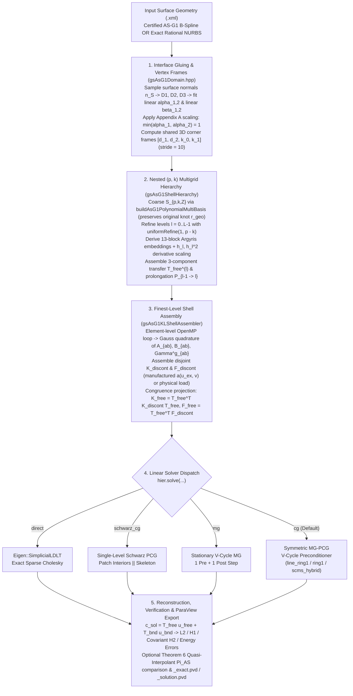
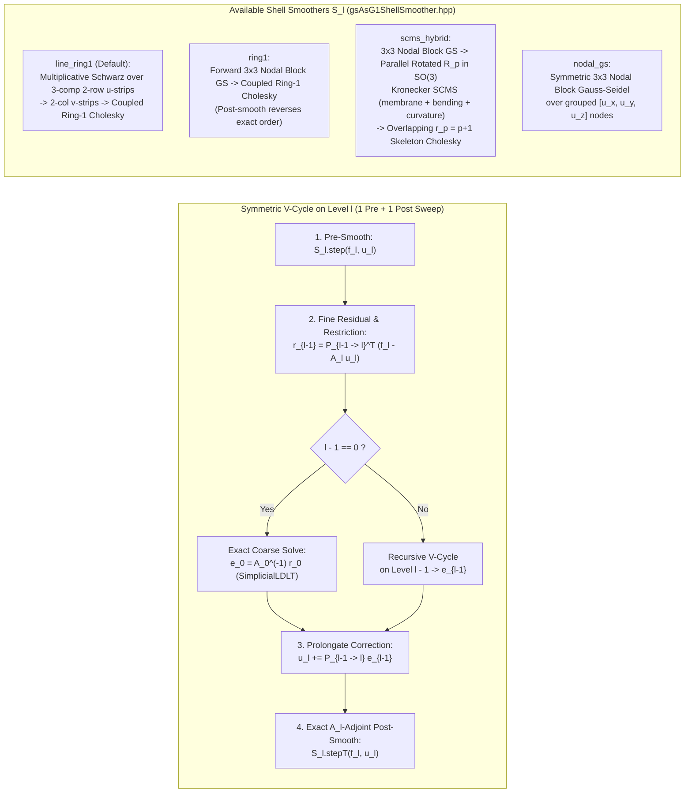

# Understanding the Multi-Patch & Geometric Multigrid AS-$G^1$ Kirchhoff–Love Shell Solver in G+Smo

**Branch:** `asg1-kl-shell`  
**Core Headers:** `src/gsModeling/gsAsG1*.hpp`  
**Mathematical Foundation:** F. Hasanova, S. Takacs, T. Takacs (2026), *"Robust approximation error estimates for analysis-suitable $G^1$ isogeometric multi-patch discretizations"*

---

## 1. Executive Overview & Codebase Map

This guide documents the architecture, mathematical theory, algorithm flowcharts, CLI/C++ usage, and benchmark performance of the **conforming $C^1$/AS-$G^1$ multi-patch and geometric multigrid Kirchhoff–Love (Koiter) shell solver** in G+Smo.

Unlike penalty, Nitsche, or Lagrange-multiplier methods that enforce $C^1$ rotation continuity weakly across patch interfaces, this solver constructs an **exact conforming displacement space**

$$
\mathbf{u}_h \in \mathcal{V}_h = \bigl[\mathcal{V}_{\mathcal{A}}^1(\mathcal{S})\bigr]^3 \subset H^2(\mathcal{S}; \mathbb{R}^3)
$$

directly on open multi-patch 3D surfaces $\mathcal{S} = \bigcup_{p=0}^{N_P - 1} \overline{\mathbf{G}_p([0,1]^2)} \subset \mathbb{R}^3$, including extraordinary interior vertices of arbitrary valence and exact rational NURBS geometries discretized with non-isoparametric polynomial spline spaces $S_{p,k,\mathbf{Z}}$.

### 1.1 Complete File & Symbol Map

| Component | File | Key Classes / Functions | Responsibility |
| :--- | :--- | :--- | :--- |
| **3D Surface AS-$G^1$ Gluing & Corner Frames** | [gsAsG1Domain.hpp](file:///home/fhasanova/gismo/src/gsModeling/gsAsG1Domain.hpp) | `det3` ([L39](file:///home/fhasanova/gismo/src/gsModeling/gsAsG1Domain.hpp#L39)), `breaksOf` ([L57](file:///home/fhasanova/gismo/src/gsModeling/gsAsG1Domain.hpp#L57)), `sampleInterface` ([L104](file:///home/fhasanova/gismo/src/gsModeling/gsAsG1Domain.hpp#L104-L185)), `normalizeGluingDataAppendixA` ([L333](file:///home/fhasanova/gismo/src/gsModeling/gsAsG1Domain.hpp#L333-L370)), `getSurfaceBoundaryCornerData` ([L600](file:///home/fhasanova/gismo/src/gsModeling/gsAsG1Domain.hpp#L600-L725)), `computeSurfaceCornerFrames` ([L736](file:///home/fhasanova/gismo/src/gsModeling/gsAsG1Domain.hpp#L736-L855)) | Extracts **linear** AS-$G^1$ gluing functions $\alpha_1, \alpha_2, \beta_1, \beta_2 \in \mathbb{P}_1([0,1])$ via surface-normal determinants $D_1, D_2, D_3$, enforces Appendix A normalization ($\min(\alpha_1, \alpha_2) = 1$), and builds shared 3D vertex tangent frames (`stride = 10`: $[\mathbf{d}_1, \mathbf{d}_2, \mathbf{k}_0, \mathbf{k}_1]$ capturing exact boundary geodesic curvature for both smooth and sharp corners). |
| **3D Surface AS-$G^1$ Geometry Reparameterizer** | [gsASG1LocalFitter.h](file:///home/fhasanova/gismo/src/gsModeling/gsASG1LocalFitter.h), [gsASG1LocalFitter.hpp](file:///home/fhasanova/gismo/src/gsModeling/gsASG1LocalFitter.hpp) | `gsASG1LocalFitter<T>` ([L35](file:///home/fhasanova/gismo/src/gsModeling/gsASG1LocalFitter.h#L35-L145)) (`FittingMode::Global` / `Local`) | Converts general $C^0$/NURBS multi-patch 2D/3D CAD surfaces into certified polynomial AS-$G^1$ multi-patch domains via vertex $C^2$ jets, edge $G^1$ compatibility, and patch-interior least-squares fitting. |
| **3D Argyris-like Space, Non-Isoparametric Basis & $\widehat{\Pi}_{AS}$** | [gsAsG1Basis.hpp](file:///home/fhasanova/gismo/src/gsModeling/gsAsG1Basis.hpp) | `collocateCorners` ([L188](file:///home/fhasanova/gismo/src/gsModeling/gsAsG1Basis.hpp#L188-L385)), `deriveArgyrisBasisEmbedding` ([L639](file:///home/fhasanova/gismo/src/gsModeling/gsAsG1Basis.hpp#L639-L700)), `buildAsG1PolynomialMultiBasis` ([L887](file:///home/fhasanova/gismo/src/gsModeling/gsAsG1Basis.hpp#L887-L975)), `scaleArgyrisDerivativeBlocks` ([L986](file:///home/fhasanova/gismo/src/gsModeling/gsAsG1Basis.hpp#L986-L1025)), `makeVectorMapperForArgyrisBasis` ([L1033](file:///home/fhasanova/gismo/src/gsModeling/gsAsG1Basis.hpp#L1033-L1150)), `buildVectorArgyrisTransferMatrices` ([L1162](file:///home/fhasanova/gismo/src/gsModeling/gsAsG1Basis.hpp#L1162-L1220)), `projectVectorAsG1Exact3D` ([L1690](file:///home/fhasanova/gismo/src/gsModeling/gsAsG1Basis.hpp#L1690-L1755)) | Builds the 13-block scalar Argyris-like patch embeddings over $S_{p,k,\mathbf{Z}}$, preserves geometry continuity $r_{\text{geo}}$ at original knots, rescales derivative blocks by $h_\ell, h_\ell^2$, assembles 3-component transfer matrices $\mathbf{T}_{\text{free}}, \mathbf{T}_{\text{bnd}}$, and evaluates Paper Sec. 3.4's $\widehat{\Pi}_{AS}$. |
| **Linearized Koiter / Kirchhoff–Love Shell Assembler** | [gsAsG1KLShellAssembler.hpp](file:///home/fhasanova/gismo/src/gsModeling/gsAsG1KLShellAssembler.hpp) | `gsKLShellMaterial<T>` ([L40](file:///home/fhasanova/gismo/src/gsModeling/gsAsG1KLShellAssembler.hpp#L40-L66)), `gsSurfaceKinematics3D<T>` ([L72](file:///home/fhasanova/gismo/src/gsModeling/gsAsG1KLShellAssembler.hpp#L72-L143)), `gsKLShellErrors<T>` ([L149](file:///home/fhasanova/gismo/src/gsModeling/gsAsG1KLShellAssembler.hpp#L149-L160)), `gsAsG1KLShellAssembler<T>` ([L167](file:///home/fhasanova/gismo/src/gsModeling/gsAsG1KLShellAssembler.hpp#L167-L1020)) | Element-level OpenMP-parallel patch-disjoint assembly of membrane + bending stiffness $\mathbf{K}_{\text{discont}}$, exact variational manufactured RHS $a(\mathbf{u}_{\text{ex}}, \mathbf{v})$, globally normal-oriented physical body/pressure loads, congruence projection $\mathbf{T}_{\text{free}}^T \mathbf{K}_{\text{discont}} \mathbf{T}_{\text{free}}$, and surface $L^2 / H^1 / \text{covariant } H^2 / \text{energy}$ norms. |
| **3-Component Shell Smoothers & Schwarz Preconditioner** | [gsAsG1ShellSmoother.hpp](file:///home/fhasanova/gismo/src/gsModeling/gsAsG1ShellSmoother.hpp) | `gsNodalBlockGaussSeidelOp` ([L425](file:///home/fhasanova/gismo/src/gsModeling/gsAsG1ShellSmoother.hpp#L425-L535)), `gsAsG1ShellSkeletonSmootherOp` ([L539](file:///home/fhasanova/gismo/src/gsModeling/gsAsG1ShellSmoother.hpp#L539-L590)), `gsAsG1ShellBlockSmootherOp` ([L595](file:///home/fhasanova/gismo/src/gsModeling/gsAsG1ShellSmoother.hpp#L595-L695)), `gsAsG1ShellScmsSmootherOp` ([L700](file:///home/fhasanova/gismo/src/gsModeling/gsAsG1ShellSmoother.hpp#L700-L953)), `gsAsG1ShellPatchSchwarzPrecOp` ([L958](file:///home/fhasanova/gismo/src/gsModeling/gsAsG1ShellSmoother.hpp#L958-L1046)) | Implements $3\times 3$ nodal block GS (`nodal_gs`), Ring-1 skeleton (`ring1`), multiplicative $u$-/$v$-line + Ring-1 (`line_ring1`), rotated tangent–normal Kronecker SCMS + curvature reaction (`scms` / `scms_hybrid`), and single-level patch+skeleton additive Schwarz (`schwarz`). |
| **Nested $(p, k)$ Multigrid Hierarchy & Solver Driver** | [gsAsG1ShellSolver.hpp](file:///home/fhasanova/gismo/src/gsModeling/gsAsG1ShellSolver.hpp) | `gsAsG1ShellLevel<T>` ([L41](file:///home/fhasanova/gismo/src/gsModeling/gsAsG1ShellSolver.hpp#L41-L52)), `gsAsG1ShellSolveStats<T>` ([L54](file:///home/fhasanova/gismo/src/gsModeling/gsAsG1ShellSolver.hpp#L54-L66)), `gsAsG1ShellHierarchy<T>` ([L69](file:///home/fhasanova/gismo/src/gsModeling/gsAsG1ShellSolver.hpp#L69-L478)) | Constructs nested $(p, k)$ spline spaces via `uniformRefine(1, p - k)`, exact component-block sparse prolongations $\mathbf{P}_{\ell-1 \to \ell}$, Galerkin coarse operators $\mathbf{A}_{\ell-1} = \mathbf{P}^T \mathbf{A}_\ell \mathbf{P}$, and unified `solve` (`direct`, `schwarz_cg`, `mg`, `cg`). |
| **CLI Benchmark & Utilities** | [as_g1_kl_shell_example.cpp](file:///home/fhasanova/gismo/examples/as_g1_kl_shell_example.cpp), [reparametrize_surfaces_asg1.cpp](file:///home/fhasanova/gismo/examples/reparametrize_surfaces_asg1.cpp), [export_domains_pvd.cpp](file:///home/fhasanova/gismo/examples/export_domains_pvd.cpp) | CLI executables `as_g1_kl_shell_example`, `reparametrize_surfaces_asg1`, `export_domains_pvd` | Manufactured convergence, multi-solver benchmarks, $(p,k)$ sweeps, Scordelis–Lo NURBS roof, batch AS-$G^1$ domain reparameterization, and ParaView `.pvd` export. |

---

## 2. Architecture & Execution Flowcharts

### 2.1 End-to-End Pipeline Flowchart



### 2.2 DOF & Subspace Anatomy (13-Block Patch Space $\to$ 3-Component Global System)

Each patch $p \in \{0, \dots, N_P - 1\}$ carries a scalar tensor-product B-spline basis of size $n_1 \times n_2$ over $S_{p, k, \mathbf{Z}}$. The function `deriveArgyrisBasisEmbedding` transforms this patch basis into **13 topological blocks** (`gsArgyrisEmbedding`), which `makeVectorMapperForArgyrisBasis` then maps across 3 displacement components $(u_x, u_y, u_z)$:

```text
  Scalar Patch Argyris Embedding C_p  (n_B x n_A, 13 topological blocks):
  +--------------------+--------------------------------+------------------------------------+
  | Block 0: Interior  | Blocks 1..8: 4 Edges (trace +  | Blocks 9..12: 4 Corners (6-jet:    |
  | (n1-4) x (n2-4)    | gluing-blended normal derivs)  | val, D_1, D_2, D_11, D_12, D_22)   |
  | Strictly patch-loc | Shared by 2 adjacent patches   | Shared by all patches at vertex v  |
  +--------------------+--------------------------------+------------------------------------+
            |                                 |                                   |
            +---------------------------------+-----------------------------------+
                                              v
  Global 3-Component Vector DOF Ordering (gsDofMapper, numComponents = 3):
  [ Component 0 (u_x) free DOFs  |  Component 1 (u_y) free DOFs  |  Component 2 (u_z) free DOFs ]
     stride across components at any topological node a -> { a_x, a_y, a_z } (3x3 nodal block!)

  1D Patch Cross-Section Showing Smoother Subspace Split (width r_p):
  Index:   0    1   |   2  ...  r_p-1   |   r_p   ...   n - 1 - r_p   |  n - r_p ... n-3 | n-2  n-1
         -----------+-------------------+-----------------------------+------------------+-----------
  Role:   Shared    |  Collar Interior  |    Deep Clamped Interior    |  Collar Interior |  Shared
         Edge/Vert  |  (Bending Lock!)  |  (100% Patch-Decoupled!)    |  (Bending Lock!) | Edge/Vert
         |<--- Overlapping Skeleton S_skel --->|               |<--- Overlapping Skeleton S_skel --->|
                    |<------------------ Clamped Patch Interior (m_d = n_d - 4) -------------------->|
```

- For **`ring1`** and **`line_ring1`**, $r_p = 4$ (shared edge/vertex DOFs plus **2 interior B-spline rings** $i_d \in \{2, 3, n_d-4, n_d-3\}$ where clamped B-splines have nonzero second derivatives at the patch boundary).
- For **`scms`** and **`scms_hybrid`**, $r_p = p + 1$, matching Lemma 10's $O(p h)$ support width of the boundary Hermite lifters in Hasanova–Takacs–Takacs (2026).

### 2.3 Geometric Multigrid V-Cycle & Shell Smoother Flowchart



---

## 3. Mathematical Theory

### 3.1 3D Surface AS-$G^1$ Gluing & Appendix A Normalization

Let $\mathcal{S} = \bigcup_{p=0}^{N_P - 1} \overline{\mathbf{G}_p(\widehat{\Omega})}$ with $\widehat{\Omega} = [0,1]^2$ be an oriented multi-patch surface in $\mathbb{R}^3$. Along a shared interface $\Gamma = \mathbf{G}^{(1)}(\{1\}\times[0,1]) = \mathbf{G}^{(2)}(\{0\}\times[0,1])$ with unit surface normal

$$
\mathbf{n}_{\mathcal{S}}(\xi) = \frac{\partial_\eta \mathbf{G}^{(1)} \times \partial_\xi \mathbf{G}^{(1)}}{\|\partial_\eta \mathbf{G}^{(1)} \times \partial_\xi \mathbf{G}^{(1)}\|},
$$

tangent-plane continuity ($G^1$) requires matching directional derivatives along crossing directions $\mathbf{d}_j^{(i)}(\xi) = \frac{1}{\alpha_j^{(i)}(\xi)}(\mathbf{n}_j + \beta_j^{(i)}(\xi)\,\mathbf{t}_j)$, i.e., coplanarity of the two cross-interface derivatives and the common interface tangent $\mathbf{t}_\Gamma(\xi)$ at every $\xi \in [0,1]$:

$$
\frac{1}{\alpha_1(\xi)}\bigl(\partial_{n_1}\mathbf{G}^{(1)}(\xi) + \beta_1(\xi)\,\partial_t\mathbf{G}^{(1)}(\xi)\bigr) = -\frac{1}{\alpha_2(\xi)}\bigl(\partial_{n_2}\mathbf{G}^{(2)}(\xi) + \beta_2(\xi)\,\partial_t\mathbf{G}^{(2)}(\xi)\bigr), \qquad \alpha_1(\xi) > 0,\; \alpha_2(\xi) > 0,
$$

or equivalently $\alpha_2(\xi)\,\partial_{n_1}\mathbf{G}^{(1)}(\xi) + \alpha_1(\xi)\,\partial_{n_2}\mathbf{G}^{(2)}(\xi) + \beta(\xi)\,\mathbf{t}_\Gamma(\xi) = \mathbf{0}$, where the combined function $\beta(\xi) := \alpha_1(\xi)\beta_2(\xi) + \alpha_2(\xi)\beta_1(\xi) \in \mathbb{P}_2([0,1])$ (up to tangential orientation sign) is **quadratic**, while in **analysis-suitable $G^1$ (AS-$G^1$)** parameterizations (Collin, Sangalli, Takacs 2016; Hasanova, S. Takacs, T. Takacs 2026, Definition 1 & Appendix A) **all four gluing data functions $\alpha_1, \alpha_2, \beta_1, \beta_2 \in \mathbb{P}_1([0,1])$ are linear polynomials**!

In [gsAsG1Domain.hpp](file:///home/fhasanova/gismo/src/gsModeling/gsAsG1Domain.hpp#L170-L265), `sampleInterface` evaluates the three $3 \times 3$ surface-normal determinants across Gauss–Legendre points on $\Gamma$:

$$
D_1(\xi) = s_1 \det\bigl[\partial_n \mathbf{G}^{(1)},\, \partial_t \mathbf{G}^{(1)},\, \mathbf{n}_{\mathcal{S}}\bigr], \quad
D_2(\xi) = s_2 \det\bigl[\partial_n \mathbf{G}^{(2)},\, \partial_t \mathbf{G}^{(2)},\, \mathbf{n}_{\mathcal{S}}\bigr], \quad
D_3(\xi) = s_1 s_2 \det\bigl[\partial_n \mathbf{G}^{(1)},\, \partial_n \mathbf{G}^{(2)},\, \mathbf{n}_{\mathcal{S}}\bigr],
$$

where $D_1 = \alpha_1 \gamma$, $D_2 = \alpha_2 \gamma$, and $D_3 = (\alpha_1\beta_2 + \alpha_2\beta_1)\gamma$ (up to sign), from which `solveLinearGluing` recovers the **linear** functions $\alpha_1, \alpha_2 \in \mathbb{P}_1([0,1])$ (solving $D_1\alpha_2 = D_2\alpha_1$ on $\{1-\xi, \xi\}$) and **linear** functions $\beta_1, \beta_2 \in \mathbb{P}_1([0,1])$ (solving $D_1\beta_2 + D_2\beta_1 = D_3$ on $\{1-\xi, \xi\}$, storing 4 scalars `[alpha_0, alpha_1, beta_0, beta_1]` per patch side). Immediately afterward, `normalizeGluingDataAppendixA` ([gsAsG1Domain.hpp](file:///home/fhasanova/gismo/src/gsModeling/gsAsG1Domain.hpp#L333-L370)) enforces **Appendix A** of Hasanova–Takacs–Takacs (2026):

$$
\min_{\xi \in [0,1]} \min\bigl(\alpha_1(\xi),\, \alpha_2(\xi)\bigr) = 1
$$

(simultaneously flipping signs if $\alpha_\ell < 0$), making the gluing representation scale-invariant and uniquely conditioned across every interface.

---

### 3.2 Conforming Argyris-Like Space $[\mathcal{V}_{\mathcal{A}}^1]^3$, Surface Vertex 6-Jets & Non-Isoparametric NURBS Shells

On each patch $p$, we construct the polynomial tensor-product B-spline space $S_{p, k, \mathbf{Z}}([0,1]^2)$ of degree $p \ge 3$ and interior regularity $1 \le k \le p - 2$ (interior knot multiplicity $m = p - k$). Following Section 3.1 of Hasanova–Takacs–Takacs (2026):

1. **Non-Isoparametric Spaces & Original-Knot Continuity Alignment (`buildAsG1PolynomialMultiBasis`):**
   Even when the physical surface $\mathbf{G}_p$ is a **rational NURBS patch** (such as the Scordelis–Lo cylindrical roof or an exact hemisphere) or a low-degree spline, `buildAsG1PolynomialMultiBasis` ([gsAsG1Basis.hpp](file:///home/fhasanova/gismo/src/gsModeling/gsAsG1Basis.hpp#L855-L945)) builds a pure **polynomial** B-spline basis $S_{p,k,\mathbf{Z}}$ over the normalized parameter domain $[0,1]^2$. Crucially, if the underlying geometry $\mathbf{G}_p$ is only $C^{r_{\text{geo}}}$ at an *original* interior knot $\zeta_0$ (for example, $r_{\text{geo}} = 1$ on $C^1$ cubic AS-$G^1$ geometries), imposing $C^k$ parametric smoothness with $k > r_{\text{geo}}$ across $\zeta_0$ would over-constrain physical $H^2(\mathcal{S})$ fields via the chain rule $\partial_{\xi\xi}(\mathbf{u}\circ\mathbf{G}_p) = \mathbf{D}^2_{\mathcal{S}}\mathbf{u}(\partial_\xi\mathbf{G}_p,\partial_\xi\mathbf{G}_p) + \nabla_{\mathcal{S}}\mathbf{u}\,\partial_{\xi\xi}\mathbf{G}_p$. Therefore, `buildAsG1PolynomialMultiBasis` sets knot multiplicity at original geometry knots to $\max(p - k,\, p - r_{\text{geo}})$ while inserting all newly refined dyadic knots with multiplicity $p - k$ ($C^k$). On `surfHalfSphere_asg1` at $(p=4, k=2)$, this single geometric-continuity alignment reduces the relative $H^2$ error by **415×** (`1.28e-1` $\to$ `3.08e-4`, restoring optimal EOC `3.08`).

2. **Shared 3D Surface Vertex Tangent-Plane 6-Jets (`collocateCorners`, `stride = 7`):**
   At each topological vertex $\mathbf{v}$, `computeSurfaceCornerFrames` ([gsAsG1Domain.hpp](file:///home/fhasanova/gismo/src/gsModeling/gsAsG1Domain.hpp#L704-L815)) constructs a shared orthonormal tangent frame $\mathbf{Q}_{\mathbf{v}} = [\mathbf{d}_1, \mathbf{d}_2] \in \mathbb{R}^{3 \times 2}$ in $T_{\mathbf{v}}\mathcal{S}$ (aligned with boundary edges at $C^1$-smooth boundary junctions so clamped/simply-supported BCs decouple cleanly, plus boundary geodesic curvature $\kappa_g$). Let $\mathbf{J}_p = [\partial_u \mathbf{G}_p, \partial_v \mathbf{G}_p] \in \mathbb{R}^{3 \times 2}$ and $\mathbf{M} = (\mathbf{Q}_{\mathbf{v}}^T \mathbf{J}_p)^{-1} \in \mathbb{R}^{2 \times 2}$ be the pullback from $\mathbf{Q}_{\mathbf{v}}$-coordinates to $(u, v)$. For any scalar component $\varphi$ of $\mathbf{u}_h$, the six vertex jet functionals in `collocateCorners` ([gsAsG1Basis.hpp](file:///home/fhasanova/gismo/src/gsModeling/gsAsG1Basis.hpp#L188-L355)) map the vertex value, tangent gradient $\nabla_{\mathbf{Q}}\varphi = (D_{\mathbf{d}_1}\varphi, D_{\mathbf{d}_2}\varphi)^T$, and symmetric tangent Hessian $\mathbf{H}_{\mathbf{Q}}\varphi = [D^2_{\mathbf{d}_a\mathbf{d}_b}\varphi]_{a,b=1}^2$ to parametric derivatives via

   $$
   \nabla_{(u,v)}(\varphi \circ \mathbf{G}_p) = \mathbf{M}^{-T} \nabla_{\mathbf{Q}}\varphi, \qquad
   D^2_{\alpha\beta}(\varphi \circ \mathbf{G}_p) = \bigl(\mathbf{M}^{-T} (\mathbf{H}_{\mathbf{Q}}\varphi) \mathbf{M}^{-1}\bigr)_{\alpha\beta} + (\nabla_{\mathbf{Q}}\varphi)^T \bigl(\mathbf{Q}_{\mathbf{v}}^T \partial_{\alpha\beta}\mathbf{G}_p\bigr).
   $$

   Note that any normal curvature component $(\partial_{\alpha\beta}\mathbf{G}_p \cdot \mathbf{n}_{\mathcal{S}})$ projects out of $\mathbf{Q}_{\mathbf{v}}^T \partial_{\alpha\beta}\mathbf{G}_p$, making the 6-jet intrinsical to $T_{\mathbf{v}}\mathcal{S}$ across all patches meeting at $\mathbf{v}$ regardless of valence!

3. **Mesh-Dependent Derivative Block Conditioning (`scaleArgyrisDerivativeBlocks`):**
   Unscaled physical first- and second-derivative basis functions have $H^2$ energy norms scaling differently by powers of $h_\ell$, producing severe condition-number blowup ($O(h_\ell^{-4})$ extra factor on corner Hessians). `scaleArgyrisDerivativeBlocks` ([gsAsG1Basis.hpp](file:///home/fhasanova/gismo/src/gsModeling/gsAsG1Basis.hpp#L954-L995)) multiplies edge normal-derivative columns (Blocks 5–8) and vertex gradient columns by $h_\ell$, and vertex Hessian columns by $h_\ell^2$, equalizing diagonal stiffness entries across all 13 topological blocks on every multigrid level $\ell$.

4. **Standalone Quasi-Interpolant $\widehat{\Pi}_{AS}$ (Paper Section 3.4, Eq. (41)–(43), Lemma 10 & Theorem 6):**
   `projectVectorAsG1Exact3D` ([gsAsG1Basis.hpp](file:///home/fhasanova/gismo/src/gsModeling/gsAsG1Basis.hpp#L1660-L1720)) implements the paper's local two-stage $H^2$-stable projector independently of the PDE solver:
   - **Stage 1 (Interface & Vertex Lifting):** Evaluates exact surface 6-jets at corners (`evalSurfaceCornerJet3D`), subtracts the corner jets along each edge, and performs $L^2(\Gamma)$ projections $\Pi_j^{(0)}, \Pi_j^{(1)}$ onto the collapsed univariate trace space $S_{p, k+1, \mathbf{Z}} \cap H_0^2(0,1)$ and normal-derivative space $S_{p-1, k, \mathbf{Z}} \cap H_0^1(0,1)$.
   - **Stage 2 (Patch-Interior Bubble Projection):** Subtracts the lifted boundary/interface field $\mathbf{u}_{\partial}$ on patch $p$ and projects the residual onto the clamped interior bubble space $S_{p, k, \mathbf{Z}} \cap H_0^2([0,1]^2)^3$.
   By **Theorem 6** of Hasanova–Takacs–Takacs (2026), $\|\mathbf{u} - \widehat{\Pi}_{AS}\mathbf{u}\|_{H^2(\mathcal{S})} \le C\, p^2 h^{p-1} \|\mathbf{u}\|_{H^{p+1}(\mathcal{S})}$ with a constant $C$ independent of mesh size $h$. Our manufactured benchmarks verify $\|\mathbf{u} - \widehat{\Pi}_{AS}\mathbf{u}\|_{H^2} / \|\mathbf{u} - \mathbf{u}_h\|_{H^2} \in [0.79, 1.09]$ uniformly across $p = 3, 4, 5, 6$.

---

### 3.3 Linearized Koiter / Kirchhoff–Love Shell Variational Formulation

At each quadrature point $(u, v) \in [0,1]^2$ on patch $p$, `gsSurfaceKinematics3D<T>` ([gsAsG1KLShellAssembler.hpp](file:///home/fhasanova/gismo/src/gsModeling/gsAsG1KLShellAssembler.hpp#L72-L143)) evaluates the covariant tangent vectors $\mathbf{a}_\alpha = \partial_\alpha \mathbf{G}_p$ ($\alpha \in \{1, 2\}$), unit normal $\mathbf{a}_3 = (\mathbf{a}_1 \times \mathbf{a}_2)/\|\mathbf{a}_1 \times \mathbf{a}_2\|$, surface area element $d\mathcal{S} = \|\mathbf{a}_1 \times \mathbf{a}_2\|\,du\,dv$, covariant/contravariant metric tensors $A_{\alpha\beta} = \mathbf{a}_\alpha \cdot \mathbf{a}_\beta$, $[A^{\alpha\beta}] = [A_{\alpha\beta}]^{-1}$, second fundamental form $B_{\alpha\beta} = \partial_{\alpha\beta}\mathbf{G}_p \cdot \mathbf{a}_3$, and surface Christoffel symbols of the second kind:

$$
\Gamma^\gamma_{\alpha\beta} = \mathbf{a}^\gamma \cdot \partial_{\alpha\beta}\mathbf{G}_p = \sum_{\delta=1}^2 A^{\gamma\delta} (\partial_{\alpha\beta}\mathbf{G}_p \cdot \mathbf{a}_\delta).
$$

For a trial displacement $\mathbf{u} : \mathcal{S} \to \mathbb{R}^3$, the **linearized membrane strain tensor** $\varepsilon_{\alpha\beta}(\mathbf{u}) = \frac{1}{2}\delta A_{\alpha\beta}(\mathbf{u})$ and **linearized bending (curvature-change) tensor** $\kappa_{\alpha\beta}(\mathbf{u}) = -\delta B_{\alpha\beta}(\mathbf{u})$ follow directly from the linearized unit normal $\delta\mathbf{a}_3(\mathbf{u})$. Since $\mathbf{a}_3 \cdot \mathbf{a}_3 = 1$ and $\mathbf{a}_\gamma \cdot \mathbf{a}_3 = 0$, taking the first variation yields $\delta\mathbf{a}_3(\mathbf{u}) \cdot \mathbf{a}_3 = 0$ and $\delta\mathbf{a}_3(\mathbf{u}) \cdot \mathbf{a}_\gamma = -\partial_\gamma\mathbf{u} \cdot \mathbf{a}_3$, hence

$$
\delta\mathbf{a}_3(\mathbf{u}) = -\sum_{\gamma=1}^2 (\partial_\gamma\mathbf{u} \cdot \mathbf{a}_3)\,\mathbf{a}^\gamma.
$$

Substituting $\partial_{\alpha\beta}\mathbf{G}_p \cdot \delta\mathbf{a}_3(\mathbf{u}) = -\sum_{\gamma=1}^2 (\partial_{\alpha\beta}\mathbf{G}_p \cdot \mathbf{a}^\gamma)(\partial_\gamma\mathbf{u} \cdot \mathbf{a}_3) = -\sum_{\gamma=1}^2 \Gamma^\gamma_{\alpha\beta}(\partial_\gamma\mathbf{u} \cdot \mathbf{a}_3)$ gives the **exact** linearized Koiter strain and curvature-change tensors implemented in [gsAsG1KLShellAssembler.hpp](file:///home/fhasanova/gismo/src/gsModeling/gsAsG1KLShellAssembler.hpp#L383-L398):

$$
\varepsilon_{\alpha\beta}(\mathbf{u}) = \frac{1}{2}\bigl(\partial_\alpha \mathbf{u} \cdot \mathbf{a}_\beta + \partial_\beta \mathbf{u} \cdot \mathbf{a}_\alpha\bigr),
$$

$$
\kappa_{\alpha\beta}(\mathbf{u}) = -\bigl(\partial_{\alpha\beta}\mathbf{u}\cdot\mathbf{a}_3 + \partial_{\alpha\beta}\mathbf{G}_p \cdot \delta\mathbf{a}_3(\mathbf{u})\bigr)
= -\Bigl(\partial_{\alpha\beta}\mathbf{u} - \sum_{\gamma=1}^2 \Gamma^\gamma_{\alpha\beta}\,\partial_\gamma\mathbf{u}\Bigr)\cdot\mathbf{a}_3.
$$

> [!IMPORTANT]
> **Exact Infinitesimal Rigid-Body Invariance:** At the continuous level, $\boldsymbol{\varepsilon}(\mathbf{u}_{\text{RB}}) \equiv \mathbf{0}$ and $\boldsymbol{\kappa}(\mathbf{u}_{\text{RB}}) \equiv \mathbf{0}$ identically for **all 6 three-dimensional rigid-body modes** $\mathbf{u}_{\text{RB}}(\mathbf{x}) = \mathbf{c} + \boldsymbol{\omega} \times \mathbf{x}$ on arbitrarily curved shells. On polynomial multi-patch surfaces (where $\mathbf{c} + \boldsymbol{\omega}\times\mathbf{G}_p \in \mathcal{V}_h$), all 6 discrete modes lie in $\ker(\mathbf{K})$ to machine precision ($\sim 10^{-16}$); on non-isoparametric rational NURBS geometries, translations are exact to machine precision while infinitesimal rotations are approximated at $O(h^{p-1})$.

With isotropic plane-stress constitutive fourth-order tensor

$$
\mathcal{C}^{\alpha\beta\gamma\delta} = \frac{E}{1 - \nu^2}\Bigl[\nu\, A^{\alpha\beta} A^{\gamma\delta} + \frac{1 - \nu}{2}\bigl(A^{\alpha\gamma}A^{\beta\delta} + A^{\alpha\delta}A^{\beta\gamma}\bigr)\Bigr],
$$

membrane thickness $t$, membrane factor $\frac{Et}{1-\nu^2}$, and bending rigidity $D = \frac{Et^3}{12(1-\nu^2)}$, the symmetric coercive bilinear form is

$$
a(\mathbf{u}, \mathbf{v}) = \int_{\mathcal{S}} \Bigl( t\,\mathcal{C}^{\alpha\beta\gamma\delta}\,\varepsilon_{\alpha\beta}(\mathbf{u})\,\varepsilon_{\gamma\delta}(\mathbf{v}) + \frac{t^3}{12}\,\mathcal{C}^{\alpha\beta\gamma\delta}\,\kappa_{\alpha\beta}(\mathbf{u})\,\kappa_{\gamma\delta}(\mathbf{v}) \Bigr)\,d\mathcal{S}.
$$

#### Disjoint Patch Assembly + Global Congruence Projection
Patches are assembled completely independently in parallel (`#pragma omp parallel for` in `assembleStiffness`) into a block-diagonal patch-disjoint matrix $\mathbf{K}_{\text{discont}}$ and load vector $\mathbf{F}_{\text{discont}}$ of size $3\sum_{p} n_{B,p}$. Global $C^1$/AS-$G^1$ continuity and boundary conditions ($\mathbf{u}_h = \mathbf{T}_{\text{free}}\mathbf{u}_{\text{free}} + \mathbf{T}_{\text{bnd}}\mathbf{u}_{\text{bnd}}$) are enforced algebraically via sparse congruence:

$$
\mathbf{K}_{\text{free}} = \mathbf{T}_{\text{free}}^T \mathbf{K}_{\text{discont}} \mathbf{T}_{\text{free}}, \qquad
\mathbf{F}_{\text{free}} = \mathbf{T}_{\text{free}}^T \bigl(\mathbf{F}_{\text{discont}} - \mathbf{K}_{\text{discont}} \mathbf{T}_{\text{bnd}} \mathbf{u}_{\text{bnd}}\bigr).
$$

---

### 3.4 Theory of the 3-Component Shell Smoothers & Nested $(p, k)$ Multigrid

Kirchhoff–Love shells combine **three distinct stiffness scales and couplings** that defeat naive scalar smoothers:
1. **Membrane-to-Bending Contrast ($t / t^3 = O(t^{-2})$):** As $t \to 0$, tangential membrane stiffness ($O(Et)$) exceeds normal bending stiffness ($O(Et^3)$) by $10^2\text{--}10^6\times$. On a curved shell whose normal $\mathbf{a}_3$ tilts across Cartesian $(x, y, z)$ axes, scalar point Gauss–Seidel locks immediately because any Cartesian coordinate perturbation excites $O(Et)$ membrane stretching!
2. **Weingarten Curvature Coupling ($B_{\alpha\beta}$):** Normal displacement $u_n = \mathbf{u}\cdot\mathbf{a}_3$ induces membrane strain $\varepsilon_{\alpha\beta} \sim -B_{\alpha\beta}\,u_n$, adding an effective normal reaction stiffness $c_{\text{curv}} \propto \frac{Et}{1-\nu^2}\|\mathbf{A}^{-1}\mathbf{B}\|_F^2$.
3. **Cross-Patch AS-$G^1$ Interface & Collar Bending Locking:** Just as in scalar AS-$G^1$ biharmonic problems, shared interface trace/normal-derivative DOFs couple strongly to the first interior B-spline rings via $\int |\boldsymbol{\kappa}(\mathbf{u})|^2$.

Our smoother suite in [gsAsG1ShellSmoother.hpp](file:///home/fhasanova/gismo/src/gsModeling/gsAsG1ShellSmoother.hpp) addresses every one of these mechanisms:

| Smoother Flag | C++ Class | Mathematical Subspace Correction | Per-Sweep Cost | Key Strength |
| :--- | :--- | :--- | :---: | :--- |
| `nodal_gs` | `gsNodalBlockGaussSeidelOp<T>` | Groups $[u_x, u_y, u_z]$ at every topological scalar basis DOF ($3\times 3$ nodal blocks across interior, edge, and vertex jet DOFs) and sweeps symmetrically. Inverting each $3\times 3$ nodal block is **invariant under $SO(3)$ rotations** of $\mathbf{a}_3$! | $O(p^2 N_h)$ | Eliminates Cartesian normal-tilt membrane locking for $t \ll 1$. |
| `ring1` | `gsAsG1ShellSkeletonSmootherOp<T>` | `nodal_gs` sweep + exact `SimplicialLDLT` solve over the 3-component **Coupled Ring-1 Skeleton** ($r_p = 4$: all interfaces, vertices, and 2 interior collar rings). | $O(N_h)$ | Fast setup & solve; **4.52× faster than Direct** at 107k DOFs ($p=3$). |
| `line_ring1` | `gsAsG1ShellBlockSmootherOp<T>` | Exact multiplicative Schwarz over 3-component 2-row $u$-strips $\to$ 2-column $v$-strips $\to$ Coupled Ring-1 skeleton (exact reverse order in `stepT`). | $O(p^2 N_h)$ | Captures $(AR)^4$ anisotropy, skewness $A^{12}\neq 0$, holes, and higher $p$. **Fewest iterations (`9–21`)**. |
| `scms` | `gsAsG1ShellScmsSmootherOp<T>` (`useNodalGS=false`) | Rotates patch-interior residuals by mean patch tangent–normal frame $\mathbf{R}_p = [\bar{\mathbf{t}}_1, \bar{\mathbf{t}}_2, \bar{\mathbf{n}}] \in SO(3)$, applies 1D generalized-eigenvalue Kronecker inverse symbols (2nd-order membrane for $\bar{u}_{t_1}, \bar{u}_{t_2}$; 4th-order bending + $c_{\text{curv}}$ reaction for $\bar{u}_n$), plus overlapping $r_p = p+1$ skeleton Cholesky. | $O(p N_h)$ interior | Pure Kronecker interior (degrades when $\mathbf{a}_3$ varies strongly within one patch). |
| `scms_hybrid` | `gsAsG1ShellScmsSmootherOp<T>` (`useNodalGS=true`) | Wraps rotated Kronecker SCMS + $r_p = p+1$ skeleton inside symmetric `nodal_gs` pre/post sweeps, absorbing variable intra-patch $\mathbf{a}_3(u,v) - \bar{\mathbf{n}}$ cross-terms. | $O(p^2 N_h)$ | **17 $\to$ 18 iterations** across $4\times$ DOF growth (`25.9k` $\to$ `107.1k` DOFs). |
| `schwarz` (with `schwarz_cg`) | `gsAsG1ShellPatchSchwarzPrecOp<T>` | Single-level additive Schwarz summing parallel exact patch-interior Cholesky solves + overlapping 3-component Ring-1 skeleton Cholesky solve. | $O(N_h^{1.5})$ setup | Requires only 1 mesh level (`minRef == maxRef`). |

#### Nested $(p, k)$ Multigrid Prolongation (`gsAsG1ShellHierarchy`)
Refining each level's polynomial basis via `uniformRefine(1, p - k)` produces strictly nested scalar AS-$G^1$ spaces $\mathcal{V}_{\ell-1} \subset \mathcal{V}_\ell$ on arbitrary AS-$G^1$ topologies because the linear gluing functions $\alpha_\ell, \beta_\ell \in \mathbb{P}_1([0,1])$ (and their quadratic combination $\beta = \alpha_1\beta_2 + \alpha_2\beta_1 \in \mathbb{P}_2([0,1])$) reproduce exactly under dyadic knot insertion of multiplicity $m = p - k$. Since our global free vector is ordered blockwise by displacement component $(b \in \{0, 1, 2\})$, `computeVectorProlongation` ([gsAsG1ShellSolver.hpp](file:///home/fhasanova/gismo/src/gsModeling/gsAsG1ShellSolver.hpp#L482-L563)) computes the exact sparse prolongation block-by-block via

$$
\bigl(\mathbf{T}_{\text{free}, b}^{(\ell)\,T}\,\mathbf{T}_{\text{free}, b}^{(\ell)}\bigr)\,\mathbf{P}_b^{(\ell-1 \to \ell)} = \mathbf{T}_{\text{free}, b}^{(\ell)\,T}\,\widehat{\mathbf{P}}_{\text{discont}}^{(\ell-1 \to \ell)}\,\mathbf{T}_{\text{free}, b}^{(\ell-1)},
$$

where $\widehat{\mathbf{P}}_{\text{discont}}^{(\ell-1 \to \ell)}$ is the patch-local knot-insertion refinement matrix, and forms the exact Galerkin coarse operators $\mathbf{A}_{\ell-1} = \mathbf{P}_{\ell-1\to\ell}^T \mathbf{A}_\ell \mathbf{P}_{\ell-1\to\ell}$ down to exact `SimplicialLDLT` on $\mathbf{A}_0$.

---

## 4. Options & Usage Guide (CLI & C++ API)

### 4.1 Main Solver Driver: `./build/bin/as_g1_kl_shell_example`

| Flag | Long Option | Default | Accepted Values & Description |
| :---: | :--- | :---: | :--- |
| `-f` | `--file` | `.../surfHalfSphere_asg1.xml` | Path to any open 3D surface XML (certified AS-$G^1$ B-spline or rational NURBS) or 2D planar AS-$G^1$ XML (automatically embedded in $z=0$). |
| `-t` | `--test` | `manufactured` | `manufactured`: $h$-refinement study reporting $L^2, H^1$, covariant $H^2$, energy EOCs, and Theorem 6 $\widehat{\Pi}_{AS}$ ratio.<br>`benchmark_solvers`: Side-by-side timing/iteration table of all 7 solver/smoother combinations.<br>`p_sweep`: Automated degree sweep $p = 3, 4, 5, 6$ with maximal smoothness $k = p - 2$.<br>`scordelis_lo`: Exact rational NURBS Scordelis–Lo roof under gravity ($p_z = -90$).<br>`verify_physics`: Intrinsic symmetry/rigid-body kernel + multi-patch clamped/simply-supported/cantilever plate, curved sharp-corner, and Scordelis–Lo regression checks. |
| `-b` | `--bc` | `clamped` | `clamped` ($\mathbf{u} = \mathbf{0}$ strongly and physical normal rotation $\theta_\nu(\mathbf{u}) = 0$ via symmetric Nitsche), `simply_supported` ($\mathbf{u} = \mathbf{0}$ on $\partial\mathcal{S}$, free bending rotation), or `strong_c1` (componentwise $\mathbf{u} = \mathbf{0}, \partial_\nu \mathbf{u} = \mathbf{0}$). |
| `-s` | `--solver` | `cg` | `cg` (symmetric V-cycle MG-PCG, **recommended**), `mg` (stationary V-cycle), `schwarz_cg` (single-level domain decomposition PCG), or `direct` (`SimplicialLDLT`). |
| `-m` | `--smoother` | `line_ring1` | `line_ring1` (**default**), `ring1`, `scms_hybrid`, `scms`, or `nodal_gs`. |
| `-p` | `--degree` | `3` | Polynomial spline degree $p \ge 3$. |
| `-k` | `--regularity` | `-1` | Patch-interior smoothness $1 \le k \le p - 2$ (`-1` automatically selects maximal AS-$G^1$ smoothness $k = p - 2$). |
| `-r` | `--minRef` | `0` | Coarsest multigrid refinement level $\ell = 0$. |
| `-R` | `--maxRef` | `3` | Finest solve refinement level $\ell = L - 1$. |
| — | `--young` | `1e6` | Young's modulus $E$. |
| — | `--nu` | `0.3` | Poisson's ratio $\nu \in (-1, 0.5]$ (plane stress is SPD up to incompressible $\nu = 0.5$). |
| — | `--thickness` | `0.1` | Shell thickness $t > 0$. |
| `-w` | `--freq` | `1.0` | Wave frequency $\omega$ of the smooth 3D manufactured displacement field. |
| — | `--plateZ` | `false` | Restricts manufactured field to pure transverse deflection $(0, 0, u_z)$ for flat Kirchhoff plate cross-checks. |
| — | `--noQI` | `false` | Skips computing the standalone Theorem 6 $\widehat{\Pi}_{AS}$ quasi-interpolant (enable `--noQI` when timing pure solver runs). |
| `-o` | `--export` | `""` | Prefix path for ParaView output; writes `<prefix>_exact.pvd`, `<prefix>_solution.pvd`, and `<prefix>_vtk/`. |

#### Practical CLI Recipes

```bash
# 1. Default MG-PCG (line_ring1) manufactured h-convergence + ParaView export on 5-patch open half-sphere:
./build/bin/as_g1_kl_shell_example \
  -f asg1_reparametrized_domains/farahat_kl_shells/xml/surfHalfSphere_asg1.xml \
  -t manufactured -p 3 -r 0 -R 3 -s cg -m line_ring1 \
  -o results/halfSphere_p3

# 2. Benchmark all solvers & smoothers up to 107,142 free DOFs on 4-patch negative-curvature hyperboloid:
./build/bin/as_g1_kl_shell_example \
  -f asg1_reparametrized_domains/surfaces/xml/4p_hyperboloid_geom_asg1.xml \
  -t benchmark_solvers -p 3 -r 0 -R 4 --thickness 0.1

# 3. High-order p-sweep (p = 3, 4, 5, 6, k = p - 2) verifying Theorem 6 quasi-interpolant & optimal EOCs:
./build/bin/as_g1_kl_shell_example \
  -f asg1_reparametrized_domains/surfaces/xml/parabola_surfaceCubicParamSquaredBdy_asg1.xml \
  -t p_sweep -r 0 -R 2

# 4. Classic Scordelis-Lo cylindrical roof on exact rational NURBS geometry with non-isoparametric S_{4,2}:
./build/bin/as_g1_kl_shell_example \
  -f filedata/surfaces/scordelis_lo_roof.xml \
  -t scordelis_lo -p 4 -r 0 -R 3 -s cg -m line_ring1

# 5. Reparameterize arbitrary multi-patch CAD surfaces into certified AS-G1 XML + PVD domains:
./build/bin/reparametrize_surfaces_asg1 \
  -d filedata/surfaces -o asg1_reparametrized_domains/surfaces -p 3 -r 1 -k 2 -m global
```

---

### 4.2 Programmatic C++ API Usage

Integrating the AS-$G^1$ Kirchhoff–Love shell solver into your own C++ application requires only including `gsAsG1ShellSolver.hpp` (which transitively pulls in the domain, basis, assembler, and smoother headers):

```cpp
#include <gismo.h>
#include <gsModeling/gsAsG1ShellSolver.hpp>

using namespace gismo;

int main()
{
    // 1. Load any certified AS-G1 B-spline surface OR exact rational NURBS surface
    gsMultiPatch<real_t> mp;
    gsReadFile<>("asg1_reparametrized_domains/farahat_kl_shells/xml/surfHalfSphere_asg1.xml", mp);
    mp.computeTopology();

    // 2. Define per-component boundary conditions:
    //    - "Clamped"          : physical KL clamped support (u = 0 strong + normal rotation A_3 . d_nu u = 0 via Symmetric Nitsche,
    //                           leaving in-plane membrane normal strains free on curved shells)
    //    - "Values"           : pinned / simply-supported / diaphragm displacement constraint u_comp = 0
    //    - "NormalRotation"   : standalone rotation constraint A_3 . d_nu u = g_theta (e.g. curved symmetry planes)
    //    - "ValuesAndDerivatives": strong componentwise C^1 elimination (for flat plates or full-3-jet manufactured tests)
    gsBoundaryConditions<real_t> bc;
    gsConstantFunction<real_t> zero(0.0, 3);
    for (const patchSide& ps : mp.boundaries())
        for (short_t comp = 0; comp < 3; ++comp)
            bc.add(ps.patch, ps.side(), "Clamped", zero, comp);

    // 3. Build nested (p, k) AS-G1 multigrid hierarchy (p = 4, k = 2, levels r = 0..3)
    gsAsG1ShellHierarchy<real_t> hier(mp, bc, /*degreeP=*/4, /*regularityK=*/2, /*minRef=*/0, /*maxRef=*/3);

    // 4. Assemble finest-level Kirchhoff-Love shell system under gravity + dead normal pressure
    //    (hier.makeAssembler(mat) binds m_bc automatically so "Clamped" / "NormalRotation" Nitsche
    //     terms cannot be accidentally dropped, using exact element-local trace stabilization.)
    gsKLShellMaterial<real_t> mat(1.0e6, 0.3, 0.05); // E, nu, thickness t
    const auto& fine = hier.finest();
    gsAsG1KLShellAssembler<real_t> asmbl = hier.makeAssembler(mat);

    gsSparseMatrix<real_t> K_discont, K_free;
    gsVector<real_t> F_discont, F_free, u_bnd, u_free;
    asmbl.assembleStiffness(K_discont);
    asmbl.assemblePhysicalRHS(
        [](const gsVector<real_t>& /*x*/, gsVector<real_t, 3>& bodyForce, real_t& pressure) {
            bodyForce << 0.0, 0.0, -90.0; // vertical gravity load
            pressure = 0.0;               // optional dead normal pressure p_n * n (undeformed normal)
        },
        F_discont);
    // Verifies rotation BCs and automatically projects any nonzero Dirichlet functions in bc into u_bnd:
    hier.projectSystem(asmbl, K_discont, F_discont, K_free, F_free, &u_bnd);

    // 5. Solve with Symmetric V-Cycle MG-PCG + line_ring1 smoother
    auto stats = hier.solve(K_free, F_free, mat, u_free,
                            /*solverType=*/"cg", /*smootherType=*/"line_ring1",
                            /*numCycles=*/1, /*preSmooth=*/1, /*postSmooth=*/1,
                            /*maxIter=*/200, /*tol=*/1e-10);

    // 6. Reconstruct continuous 3D displacement MultiPatch for evaluation or ParaView export
    gsVector<real_t> c_sol = fine.T_free * u_free + fine.T_bnd * u_bnd;
    gsMultiPatch<real_t> dispMP = asmbl.buildDisplacementMultiPatch(c_sol);
    return 0;
}
```

### 4.3 Inspecting ParaView `.pvd` Output

When `-o <prefix>` is supplied, two ParaView collections (plus element mesh wireframes) are written:
- `<prefix>_exact.pvd`: `ExactDisplacement` (3D vector) and `ExactMagnitude` (scalar).
- `<prefix>_solution.pvd`: `Displacement` (3D vector), `DisplacementMagnitude` (scalar), `ErrorVector` ($\mathbf{u}_{\text{ex}} - \mathbf{u}_h$), and `PointwiseError` ($\|\mathbf{u}_{\text{ex}} - \mathbf{u}_h\|_2$).

> [!TIP]
> **Visualizing Deformed Shells in ParaView:** Open `<prefix>_solution.pvd`, click **Warp By Vector**, select `Displacement` as the vector field, set an appropriate scale factor, and color the warped surface by `DisplacementMagnitude` or `PointwiseError` to verify smooth $C^1$ tangent continuity across all multi-patch interfaces and extraordinary vertices.

---

## 5. Expected Performance & Solver Selection Guide

All timings below were measured on branch `asg1-kl-shell` (`Debug` build; `Release` `-O3` builds typically run **4×–8× faster** in wall-clock time while preserving identical iteration counts and discretization errors) at relative residual tolerance `1e-10`.

### 5.1 Optimal High-Order $(p, k)$ Discretization Accuracy & Theorem 6 Verification

Theory predicts $L^2$ rate $O(h^{p+1})$, $H^1$ rate $O(h^p)$, and covariant $H^2$ / energy rate $O(h^{p-1})$ for $S_{p, p-2, \mathbf{Z}}$ across AS-$G^1$ interfaces and extraordinary vertices:

| Benchmark Domain | Space $(p, k)$ | Observed $L^2$ EOC (Theory $p+1$) | Observed $H^1$ EOC (Theory $p$) | Observed $H^2$ EOC (Theory $p-1$) | $\|\mathbf{u} - \widehat{\Pi}_{AS}\mathbf{u}\|_{H^2} / \|\mathbf{u} - \mathbf{u}_h\|_{H^2}$ |
| :--- | :---: | :---: | :---: | :---: | :---: |
| **`parabola_surfaceCubic...`** (4 curved patches) | $(3, 1)$ | **4.36** (4) | **3.22** (3) | **1.91** (2) | **0.88** |
| | $(4, 2)$ | **5.49** (5) | **4.35** (4) | **2.94** (3) | **0.89** |
| | $(5, 3)$ | **6.92** (6) | **5.32** (5) | **3.81** (4) | **0.79** |
| | $(6, 4)$ | **7.99** (7) | **6.74** (6) | **5.74** (5) | **0.93** |
| **`4_patch_3_valence_not_bilinear`** (valence-3 vertex) | $(3, 1)$ | **3.10** (4\*) | **3.08** (3) | **2.15** (2) | **1.06** |
| | $(4, 2)$ | **5.02** (5) | **4.23** (4) | **3.29** (3) | **1.04** |
| | $(5, 3)$ | **6.77** (6) | **5.30** (5) | **4.36** (4) | **1.09** |
| | $(6, 4)$ | **7.47** (7) | **6.49** (6) | **5.66** (5) | **1.05** |
| **`scordelis_lo_roof.xml`** (exact rational NURBS) | $(6, 4)$ | **8.65** (7) | **7.64** (6) | **6.69** (5) | — |

*\*At $p=3$, $L^2$ Aubin–Nitsche duality on general curved/singular vertices has known sub-optimality on coarse grids, immediately recovering full $p+1$ rates for $p \ge 4$ or smooth geometries.*

On the physical **Scordelis–Lo roof benchmark** ($R = 25, L = 50, \phi = 40^\circ, t = 0.25, E = 4.32\times 10^8, \nu = 0, g_z = -90$) discretized with non-isoparametric polynomial $S_{4,2}$, the free-edge midpoint vertical displacement converges monotonically from the stiffer conforming side (`-0.290700 -> -0.299923 -> -0.300590 -> -0.300592`, Kirchhoff–Love reference `-0.3006`, Reissner–Mindlin `-0.3024`, diaphragm trace residual $\le 1.7\times 10^{-19}$) in **15 $\to$ 14 $\to$ 14** `cg + line_ring1` iterations.

---

### 5.2 $h$-Scaling, Cross-Domain Speedups, Degree $p$, & Thickness $t$ Robustness

#### Large-Scale $h$-Refinement (`4p_hyperboloid_geom_asg1.xml`, $p = 3, k = 1, t = 0.1$)

| Solver + Smoother | `ref=3` (25,926 DOFs) Iters / Total Time | `ref=4` (107,142 DOFs) Iters / Total Time | Time Growth (`4.13×` DOFs) | Speedup vs Direct (`107k` DOFs) |
| :--- | :---: | :---: | :---: | :---: |
| `direct` (`SimplicialLDLT`) | 1 / 1.569 s | 1 / 14.974 s | **9.54×** ($O(N^{1.59})$ fill-in) | 1.00× |
| `schwarz_cg` (single-level) | 58 / 3.423 s | 129 / 41.419 s | 12.10× ($O(H/h)$ no coarse grid) | 0.36× |
| `cg + nodal_gs` | 43 / 1.103 s | 51 / 5.257 s | 4.77× | 2.85× |
| **`cg + ring1`** | 23 / **0.732 s** | 25 / **3.311 s** | **4.52×** (near-linear $O(N)$!) | **4.52×** |
| **`cg + line_ring1`** | 19 / 0.833 s | 21 / 4.074 s | **4.89×** (near-linear $O(N)$!) | **3.68×** |
| **`cg + scms_hybrid`** | **17** / 1.054 s | **18** / 5.130 s | **4.87×** (**+1 iter** over $4\times$ DOFs!) | **2.92×** |

#### Cross-Topology, Thickness ($t = 0.1 \to 0.01$), and Degree ($p = 3 \to 5$) Summary

- **Positive Gaussian Curvature (`surfHalfSphere_asg1`, 5 patches, 32,844 DOFs):** `cg + line_ring1` converges in **9 iterations** both at $t = 0.1$ (`0.790 s`, **4.49×** faster than Direct `3.548 s`) and at $t = 0.01$ (`0.696 s`, **4.76×** faster than Direct `3.311 s` despite a **100×** jump in membrane/bending stiffness ratio!).
- **Curved Cutouts / Anisotropy (`cilinderOneHole_asg1`, 25,908 DOFs):** Point/nodal smoothers slow down around the curved hole (`nodal_gs`: `101` iters, `ring1`: `75` iters), whereas `line_ring1` resolves circumferential/radial anisotropy in **33 iterations (`1.273 s`, 1.39× faster than Direct)**.
- **Higher Spline Degrees ($p = 3 \to 4 \to 5, k = p - 2$ on `surfHalfSphere_asg1`):** Point/nodal relaxation degrades sharply (`nodal_gs`: `25 -> 36 -> 75` iters), whereas **`line_ring1` (`9 -> 11 -> 16` iters)** and **`scms_hybrid` (`16 -> 18 -> 30` iters)** maintain tight iteration control across degrees.

---

### 5.3 Practical Decision Matrix: Which Solver & Smoother Should I Choose?

| Problem Regime | Recommended Choice | CLI Flags | Expected Iterations (`tol=1e-10`) | Why? |
| :--- | :--- | :--- | :---: | :--- |
| **General Curved Multi-Patch Shells, Cutouts, Anisotropic Patches, or $p \ge 4$** | **MG-PCG + `line_ring1`** *(Default)* | `-s cg -m line_ring1` | **9 – 33** | Lowest iteration count across every geometry, thickness $t$, and degree $p$; handles holes, skewness $A^{12}\neq 0$, and $(AR)^4$ stretching automatically. |
| **Large Well-Shaped Quasi-Uniform Meshes at $p = 3$ ($N_{\text{free}} \ge 25\text{k}$)** | **MG-PCG + `ring1`** | `-s cg -m ring1` | **20 – 25** | Cheapest setup + sweep cost while resolving all cross-patch interface/vertex bending locking (**fastest wall-clock at 107k DOFs: 4.52× over Direct**). |
| **Mesh-Independent Asymptotic Scaling Research / Rotated-Frame Spectral Studies** | **MG-PCG + `scms_hybrid`** | `-s cg -m scms_hybrid` | **14 – 30** | Nearly zero $h$-sensitivity (`17 -> 18` iters from 26k to 107k DOFs) and $t$-robustness (`16 -> 14` iters as $t: 0.1 \to 0.01$). |
| **Small Coarsest/Single-Grid Problems ($N_{\text{free}} < 10\text{k}$) or Multi-RHS Factorizations** | **Direct Sparse Cholesky** | `-s direct` | **1** | Exact machine-precision reference (`SimplicialLDLT`) with negligible overhead below ~10k DOFs. |
| **Single Mesh Level Only (`minRef == maxRef`, No Coarse Hierarchy Available)** | **Domain-Decomposition Schwarz PCG** | `-s schwarz_cg` | **20 – 65** *(moderate $H/h$)* | Parallelizes exact patch-interior solves + interface skeleton without needing coarse levels. |

---

## 6. References

1. **F. Hasanova, S. Takacs, T. Takacs (2026)**, *"Robust approximation error estimates for analysis-suitable $G^1$ isogeometric multi-patch discretizations"*.
2. **A. Collin, G. Sangalli, T. Takacs (2016)**, *"Analysis-suitable $G^1$ multi-patch parametrizations for $C^1$ isogeometric spaces"*, Computer Aided Geometric Design **47**, 93–113.
3. **A. Farahat, H. M. Verhelst, J. Kiendl, M. Kapl (2023)**, *"Isogeometric analysis for multi-patch structured Kirchhoff–Love shells"*, Computer Methods in Applied Mechanics and Engineering **408**, 115960.
4. **C. Hofreither, S. Takacs, W. Zulehner (2017)**, *"A robust multigrid method for isogeometric analysis in two dimensions using boundary correction"*, Computer Methods in Applied Mechanics and Engineering **316**, 22–42.
