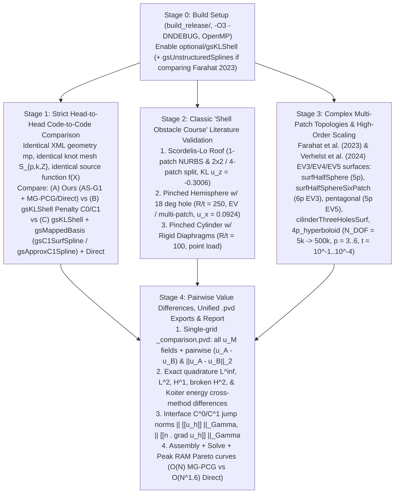

# Benchmarking Plan: AS-$G^1$ Multigrid Kirchhoff–Love Shell Solver vs. Existing IGA Implementations & Literature

## 1. Overview of Existing IGA Kirchhoff–Love Shell Approaches & Key Literature

To position and benchmark our conforming AS-$G^1$ multi-patch + geometric multigrid Kirchhoff–Love shell solver (`asg1-kl-shell`) rigorously, we compare along **two axes**:
1. **Multi-patch $C^1$ discretization & coupling** (conforming AS-$G^1$ vs. Penalty, Bending Strip, Nitsche, Mortar, and Almost-$C^1$/Approximate-$C^1$).
2. **Linear solver & preconditioning** (our nested $(p, k)$ Geometric Multigrid `MG-PCG` vs. Sparse Direct Cholesky/LU and BDDC/FETI-DP/IETI-DP).

| Approach Family | Representative IGA Papers | Available in G+Smo? | Matrix Structure & Conditioning | Strengths & Weaknesses vs. Our Method |
| :--- | :--- | :---: | :--- | :--- |
| **1. Bending Strip** | Kiendl, Bazilevs, Hsu, Wüchner, Bletzinger (*CMAME* **199**, 2010) | Via `gsKLShell` strips | SPD, strip-stiffness parameter $E_{\text{strip}}$ | Simple, no extra DOFs; non-variational, over-stiffens or locks near extraordinary vertices (EVs). |
| **2. Penalty $C^0/C^1$ Coupling** | Herrema et al. (*CMAME* **346**, 2019, `PENGoLINS`/`tIGAr`); Coradello et al. (2021); Verhelst & Kiendl (`gsKLShell`) | **Yes** (`optional/gsKLShell`: `addWeakC0` + `addWeakC1`) | SPD, but $\kappa(\mathbf{K})$ blows up with $\alpha_{\text{pen}}$ | Works on non-AS-$G^1$ / non-matching patches, but requires tuning $(\alpha_0, \alpha_1)$; small $\alpha$ leaks rotation, large $\alpha$ destroys iterative solvers. |
| **3. Symmetric / Consistent Nitsche** | Guo & Ruess (*CMAME* **284**, 2015); Benzaken, Evans, McCormick, Tamstorf (*CMAME* **374**, 2021) | Partial (boundary/interface expressions) | Symmetric (SPD if $\gamma \gtrsim C p^2/h$) | Variationally consistent & optimal rates; intricate surface moment/shear boundary integrals and stabilization constant $\gamma$. |
| **4. Dual Mortar / FETI Coupling** | Hirschler, Bouclier, Dureisseix et al. (*CMAME* **349**, 2019); Dornisch et al. (2015) | External (`gsIeti` for $C^0$/scalar) | **Indefinite saddle-point** $\begin{bmatrix}\mathbf{K} & \mathbf{B}^T \\ \mathbf{B} & \mathbf{0}\end{bmatrix}$ | Handles non-matching meshes cleanly, but loses SPD structure (cannot use standard CG/V-cycle directly). |
| **5. Conforming `gsMappedBasis` + Direct** | **Farahat, Verhelst, Kiendl, Kapl (*CMAME* 411, 2023)**; **Verhelst, Weinmüller, Mantzaflaris, T. Takacs, Toshniwal (*CMAME* 419, 2024)** | **Yes** (`gsKLShell` + `gsUnstructuredSplines`) | SPD conforming ($H^2$-elliptic) | Closest discretization baseline! Uses `gsExprAssembler` over `gsMappedBasis` + **Direct solver only** (`SimplicialLDLT` / `Pardiso`, $O(N^{1.5\text{--}2})$ time & fill-in). |
| **6. BDDC / FETI-DP / IETI-DP Solvers** | Beirão da Veiga, Pavarino, Scacchi, Widlund, Zampini (2017/2018); Schneckenleitner & S. Takacs (2020); S. Takacs (2025) | `src/gsIeti/` (core building blocks compiled) | SPD substructured, $\kappa \sim C(1+\log\frac{H}{h})^2$ | Parallel domain decomposition (typically 15–45 PCG iters with deluxe scaling), whereas our nested $(p,k)$ MG achieves **$O(1)$ mesh-independent iterations (`9–25`)** without dense interface eigensolves. |
| **7. Ours (`asg1-kl-shell`)** | Grounded in **Hasanova, S. Takacs, T. Takacs (2026)** + 3-comp shell MG (`line_ring1` / `ring1` / `scms_hybrid`) | **Implemented on branch `asg1-kl-shell`** | SPD, $h_\ell/h_\ell^2$-scaled, exact $C^1$ | **Zero penalty parameters**, exact $C^1$ across EVs, non-isoparametric NURBS support, fast patch-disjoint assembly, and **$O(N)$ MG-PCG solve**. |

---

## 2. Crucial Prerequisites for a Fair Apples-to-Apples Comparison

> [!IMPORTANT]
> **Switch from `Debug` to `Release` (`-O3 -DNDEBUG -DGISMO_WITH_OPENMP=ON`) Before Timing!**
> Our current `build/` directory is configured with `CMAKE_BUILD_TYPE=Debug` (`build/CMakeCache.txt`), which disables SIMD vectorization and inlining in Eigen and G+Smo and typically slows down assembly and sparse linear algebra by **5×–15×**. Every benchmark against `gsKLShell` and literature timings should be compiled in a dedicated `build_release/` directory so both direct solvers and MG-PCG run at full optimized speed.

### How to Enable G+Smo's Existing `gsKLShell` & `gsUnstructuredSplines` Modules
`CMakeLists.txt` (lines 295–310) and `cmake/gsFetch.cmake` natively support fetching official G+Smo optional modules from `https://github.com/gismo/<module>.git`:

```bash
# Create a separate Release build directory (keeps current Debug build intact)
mkdir -p build_release && cd build_release
cmake .. \
  -DCMAKE_BUILD_TYPE=Release \
  -DGISMO_WITH_OPENMP=ON \
  -DGISMO_OPTIONAL="gsKLShell;gsUnstructuredSplines" \
  -DGISMO_BUILD_EXAMPLES=ON
make -j8 as_g1_kl_shell_example
```
*(Note: If cloning `gsKLShell` requires network access outside the sandbox, you or I can run just the `git clone` / `cmake` fetch step once, and all builds/benchmarks run locally thereafter.)*

---

## 3. Four-Stage Experimental Comparison Plan



### Stage 1: Strict Head-to-Head Code-to-Code Comparison Inside G+Smo (`examples/compare_kl_shell_methods.cpp`)
Write a single self-contained benchmark driver that runs all methods on the **exact same `gsMultiPatch<real_t> mp` domain**, **exact same per-patch knot mesh $S_{p,k,\mathbf{Z}}$ (`dbasis`)**, **exact same quadrature order (`p + quadExtra`)**, and **exact same source/load function**:

1. **Method A — Our Conforming AS-$G^1$ (`gsAsG1KLShellAssembler` + `gsAsG1ShellHierarchy`):**
   - Solves with `MG-PCG` (`line_ring1`, `ring1`, `scms_hybrid`) and `direct` (`SimplicialLDLT`).
   - Reconstructs `gsMultiPatch<real_t> disp_ASG1 = asmbl.buildDisplacementMultiPatch(c_sol)` (inherits from `gsFunctionSet<real_t>`).
2. **Method B — `gsKLShell` Weak Penalty Coupling (`gsThinShellAssembler<3, real_t, true>` + `addWeakC0` + `addWeakC1`):**
   - Uses the **exact same** `mp` and `dbasis` ($S_{p,k,\mathbf{Z}}$ per patch) with interface penalty parameters $\alpha_{\text{pen}} \in \{10^1, 10^3, 10^5\} \cdot E$, calling linear `assembler.assemble()` for `K` and `rhs`.
   - Reconstructs **displacement** via `penAssembler.constructDisplacement(sol_Pen, disp_Pen)` (note: `constructDisplacement` returns $\mathbf{u}_h$, whereas `constructSolution` returns deformed geometry $\mathbf{G} + \mathbf{u}_h$!).
   - Quantifies both the **penalty parameter dilemma** (interface slope jump $\|\,[\![\mathbf{n}_\Gamma \cdot \nabla_{\mathcal{S}}\mathbf{u}_h]\!]\,\|_{L^2(\Gamma)}$ at small $\alpha_{\text{pen}}$ vs. $\kappa(\mathbf{K})$ blowup / CG breakdown at large $\alpha_{\text{pen}}$) and **DOF reduction** ($N_{\text{free}}^{\text{AS-}G^1} < N_{\text{free}}^{\text{Penalty}}$).
3. **Method C — `gsKLShell` + `gsUnstructuredSplines` (`gsC1SurfSpline` / `gsApproxC1Spline` $\to$ `gsMappedBasis<2, real_t>`) + Direct Solver (Farahat et al. 2023 / Verhelst et al. 2024):**
   - Builds the mapped $C^1$ / Approx-$C^1$ space over the **exact same** `mp` and $(p, k)$ parameters, assembles via `gsThinShellAssembler`, solves with `SimplicialLDLT`, and wraps the solution as a `gsMappedSpline<2, real_t>` (also a `gsFunctionSet<real_t>`!).

---

### Stage 1B: Implementation Architecture for Identical Sources, Cross-Method Value Differences & Unified `.pvd` Export

#### 1. Guaranteeing Identical Domains & Identical Source Functions
- **Shared Geometry & Basis:** Every method receives the identical in-memory `const gsMultiPatch<real_t>& mp` (normalized to $[0,1]^2$ per patch) and `const gsMultiBasis<real_t>& dbasis = hier.finest().dbasis`. When starting from a raw non-AS-$G^1$ CAD file, `gsASG1LocalFitter` generates the certified AS-$G^1$ surface once and **all methods solve on that identical surface** so patch coordinates $(p, u, v) \mapsto \mathbf{X}$ correspond 1-to-1 everywhere (with the geometric fitting tolerance $\|\mathcal{S}_{\text{AS-}G^1} - \mathcal{S}_{\text{raw}}\|_{L^\infty}$ reported separately).
- **Shared Load Wrapper (`SharedShellForceFunction : public gsFunction<real_t>`):**
  Because `gsThinShellAssembler` only accepts physical surface/pressure loads $\int_{\mathcal{S}} (\mathbf{f}_{\text{body}} + p_n \mathbf{n})\cdot\mathbf{v}\,d\mathcal{S}$ (it has no `assembleManufacturedRHS(u_ex)`), we run three complementary head-to-head source regimes using a single shared `gsFunction<real_t>` object passed to both `gsThinShellAssembler` and `gsAsG1KLShellAssembler::assemblePhysicalRHS`:
  1. **Smooth 3D Physical Body + Follower-Pressure Loads on Curved Multi-Patch Shells:** e.g. gravity $\mathbf{f} = (0, 0, -g_0)$, spatially varying 3D oscillatory loads $\mathbf{f}(x,y,z) = (f_0 \sin\omega x\cos\omega y,\, f_0\cos\omega x\sin\omega z,\, -g_0 + f_0\cos\omega(x+y))$, and normal pressure $p_n(\mathbf{X})$. All methods integrate the exact same load with matched Gauss order (`quA = p + 2`, `quB = 1`).
  2. **Exact Analytical Strong-Form Manufactured Solutions on Planar Multi-Patch EV Domains ($z = 0$):** On multi-patch planar geometries with extraordinary vertices (e.g. 5-patch pentagon, $2\times 2$ square, curved-hole plate), the strong KL operator decouples into 2D plane-stress elasticity and $D\Delta^2 u_z = f_z$. Feeding the closed-form $\mathbf{f}(x,y) = \mathcal{L}_{\text{KL}}\mathbf{u}_{\text{ex}}(x,y)$ into both assemblers gives an **exact analytical ground truth $\mathbf{u}_{\text{ex}}$** through the standard physical-load path!
  3. **Fine-Grid High-Order Overkill Reference $\mathbf{u}_{\text{ref}}$ on Curved 3D Shells:** Solve on $(p+1, r_{\max}+1)$ to obtain $\mathbf{u}_{\text{ref}}$ when measuring absolute discretization error alongside pairwise method differences on curved shells.
- **Boundary Condition Parity Check:** Note that `gsThinShellAssembler` enforces `condition_type::dirichlet` (`Values`) strongly, whereas `condition_type::clamped` enforces zero normal rotation weakly via boundary penalty (while `gsAsG1ShellHierarchy` enforces both `Values` and `ValuesAndDerivatives` strongly in $\mathcal{V}_h$). Running **both** simply-supported/diaphragm (`Values`) and clamped (`ValuesAndDerivatives`) cases cleanly separates interior/interface method differences from weak-clamping boundary layers.

#### 2. Generic Pairwise Value-Difference Engine (`ShellSolutionComparator<real_t>`)
Notice that `gsMultiPatch<real_t>` (returned by our solver and by `gsThinShellAssembler` Penalty) and `gsMappedSpline<2, real_t>` (returned by `gsC1SurfSpline` / `gsApproxC1Spline`) **both inherit from `gsFunctionSet<real_t>`**, where `.piece(p)` supports `.eval_into(pts, val)`, `.deriv_into(pts, d1)`, and `.deriv2_into(pts, d2)` at arbitrary parametric points `pts(2, nQ)` on patch `p`!

`ShellSolutionComparator<real_t>` takes `mp`, `dbasis`, `mat`, and a list of named `(name, const gsFunctionSet<real_t>*)` solutions, loops over all patch elements with $(p + 3)$-point Gauss quadrature (plus dense sample grids), and computes for **every pair $(M_1, M_2)$**:
- **Pointwise value differences:**
  $$
  \|\Delta\mathbf{u}\|_{L^\infty(\mathcal{S})} = \max_{p, q} \|\mathbf{u}_{M_1}(p,\boldsymbol{\xi}_q) - \mathbf{u}_{M_2}(p,\boldsymbol{\xi}_q)\|_2,
  \qquad
  \Delta u_{x,\max},\; \Delta u_{y,\max},\; \Delta u_{z,\max},
  $$
  together with the physical coordinates $\mathbf{X}^* = \mathbf{G}_{p^*}(\boldsymbol{\xi}_{q^*})$ where the maximum difference occurs, plus probe-point value tables (e.g. free-edge midpoint, center, load application points).
- **Exact surface-integral norm differences** (using `gsSurfaceKinematics3D` on `mp`):
  - Surface $L^2$ difference: $\|\mathbf{u}_{M_1} - \mathbf{u}_{M_2}\|_{L^2(\mathcal{S})}$ (absolute & relative to $\|\mathbf{u}_{M_1}\|_{L^2(\mathcal{S})}$),
  - Surface $H^1$ difference: $|\mathbf{u}_{M_1} - \mathbf{u}_{M_2}|_{H^1(\mathcal{S})}$ (absolute & relative),
  - Broken covariant $H^2$ difference: $\bigl(\sum_p \|\nabla^2_{\text{cov}}(\mathbf{u}_{M_1} - \mathbf{u}_{M_2})\|_{L^2(\mathcal{S}_p)}^2\bigr)^{1/2}$,
  - Koiter shell-energy norm difference: $\|\mathbf{u}_{M_1} - \mathbf{u}_{M_2}\|_{E(\mathcal{S})} = \sqrt{a_h(\mathbf{u}_{M_1} - \mathbf{u}_{M_2},\, \mathbf{u}_{M_1} - \mathbf{u}_{M_2})}$, plus total strain-energy difference $|\frac{1}{2}a(\mathbf{u}_{M_1},\mathbf{u}_{M_1}) - \frac{1}{2}a(\mathbf{u}_{M_2},\mathbf{u}_{M_2})|$.
- **Interface $C^0$ & $C^1$ jump table across all interior interfaces $\Gamma = \bigcup_{e} \Gamma_e$** (1D Gauss quadrature along `mp.interfaces()`, mapping $\boldsymbol{\xi}_1 \leftrightarrow \boldsymbol{\xi}_2$ via `boundaryInterface`):
  - Displacement jump $\|\,[\![\mathbf{u}_h]\!]\,\|_{L^2(\Gamma)}$ and $\|\,[\![\mathbf{u}_h]\!]\,\|_{L^\infty(\Gamma)}$,
  - Normal-slope / bending-rotation jump $\|\,[\![\mathbf{n}_\Gamma \cdot \nabla_{\mathcal{S}}\mathbf{u}_h]\!]\,\|_{L^2(\Gamma)}$ and $\|\,[\![\mathbf{a}_3 \cdot (\mathbf{n}_\Gamma \cdot \nabla_{\mathcal{S}}\mathbf{u}_h)]\!]\,\|_{L^\infty(\Gamma)}$.

#### 3. Unified Side-by-Side & Difference ParaView `.pvd` Output
Because `gsExprEvaluator` natively binds **any** `gsFunctionSet<real_t>` on `&mp` via `auto uM = ev.getVariable(funcSetM);`, we export a **single unified `<prefix>_comparison.pvd` collection** on the shared surface geometry `&mp` containing:
- **Every method's displacement vector & magnitude:**
  - `u_ASG1`, `u_ASG1_mag`
  - `u_Penalty_1e1`, `u_Penalty_1e3`, `u_Penalty_1e5` (and `*_mag`)
  - `u_Mapped_ASG1` (`gsC1SurfSpline`), `u_ApproxC1` (`gsApproxC1Spline`) (and `*_mag`)
  - `u_Exact` (when analytical exact solution is active)
- **Pairwise vector & scalar difference fields on the exact same VTK nodes:**
  - `diff_ASG1_vs_Penalty1e3` ($\mathbf{u}_{\text{AS-}G^1} - \mathbf{u}_{\text{Pen},10^3}$, 3D vector) and `diff_ASG1_vs_Penalty1e3_mag` ($\|\mathbf{u}_{\text{AS-}G^1} - \mathbf{u}_{\text{Pen},10^3}\|_2$, scalar)
  - `diff_ASG1_vs_MappedASG1` and `diff_ASG1_vs_MappedASG1_mag` (verifies pointwise agreement between our fast Argyris embedding + MG-PCG and `gsC1SurfSpline` + Direct!)
  - `diff_ASG1_vs_ApproxC1` and `diff_ASG1_vs_ApproxC1_mag` (visualizes EV localization differences)
  - `diff_ASG1_MG_vs_Direct_mag` (confirms algebraic solver discrepancy is $\le 10^{-10}$)
  - `err_ASG1_mag`, `err_Penalty1e3_mag`, `err_MappedASG1_mag` (when exact/overkill reference is available)
- **Companion `<prefix>_summary.csv` & `<prefix>_interfaces.vtp`:**
  - Machine-readable CSV of all norm differences, probe values, jump norms, DOF counts, and timings, plus a polyline `.vtp` along patch interfaces colored by pointwise $|[\![\mathbf{n}_\Gamma \cdot \nabla_{\mathcal{S}}\mathbf{u}_h]\!]|$ so interface rotation kinks in Penalty methods stand out immediately in ParaView!

---

### Stage 2: Classical "Shell Obstacle Course" Benchmarks Against Literature Reference Values
Validate engineering accuracy per DOF against published tables in **Kiendl et al. (2009, 2010)**, **Guo & Ruess (2015)**, **Herrema et al. (2019)**, **Benzaken et al. (2021)**, and **Farahat et al. (2023)**:

1. **Multi-Patch Scordelis–Lo Roof** ($R = 25, L = 50, \phi = 40^\circ, t = 0.25, E = 4.32\times 10^8, \nu = 0, g_z = -90$, Kirchhoff–Love ref $u_z = -0.3006$, Reissner–Mindlin ref $-0.3024$):
   - Test **both** single-patch exact NURBS (`scordelis_lo_roof.xml`, already verified!) **and** a $2\times 2$ or skewed 4-patch split (standard test in Guo & Ruess 2015 and Hirschler et al. 2019 to check whether membrane forces $n_{\alpha\beta}$ and bending moments $m_{\alpha\beta}$ cross patch interfaces smoothly without penalty oscillations).
2. **Pinched Hemisphere with $18^\circ$ Hole** ($R = 10, t = 0.04, E = 6.825\times 10^7, \nu = 0.3$, alternating radial point loads $F = \pm 2$, ref $u_x = 0.0924$):
   - Gold-standard test for **inextensional bending ($R/t = 250$)** on doubly curved multi-patch shells (`quarter_sphere.xml` / multi-patch hemisphere). Adding point-load evaluation to `gsAsG1KLShellAssembler` takes ~15 lines of C++.
3. **Pinched Cylinder with Rigid Diaphragms** ($R = 300, L = 600, t = 3, E = 3\times 10^6, \nu = 0.3$, opposing point loads $F = 1$, ref $u_r = -1.8248\times 10^{-5}$):
   - Tests localized high-gradient point-load response, rigid diaphragm BCs ($u_x = u_y = 0$ on curved ends via our per-component `bc.add(..., comp)`), and membrane/curvature coupling at $R/t = 100$.

---

### Stage 3: Extraordinary-Vertex Multi-Patch & Asymptotic Scaling Suite ($N_{\text{DOF}}$ up to $5\times 10^5$)
Using the geometries already prepared in [asg1_reparametrized_domains/farahat_kl_shells/xml/](file:///home/fhasanova/gismo/asg1_reparametrized_domains/farahat_kl_shells/xml):
- **Valence $\neq 4$ topologies from Farahat et al. (2023):**
  - `surfHalfSphereSixPatch_asg1.xml` (valence-3 extraordinary vertices, $K > 0$),
  - `pentagonalFivePatchDisturbed_asg1.xml` (valence-5 extraordinary vertex),
  - `surfHalfSphere_asg1.xml` (5-patch hemisphere),
  - `cilinderThreeHolesSurf_asg1.xml` (3 cutouts, multi-patch $K = 0$),
  - `4p_hyperboloid_geom_asg1.xml` ($K < 0$ saddle shell).
- **Scaling sweeps to measure:**
  1. **$h$-scaling (`ref = 0..5`, up to ~400k–500k DOFs in `Release`):** Wall-clock time and peak memory RSS (`/usr/bin/time -v`) for `MG-PCG` ($O(N)$) vs. `SimplicialLDLT` ($O(N^{1.6})$) vs. `gsKLShell` Penalty + Direct/CG.
  2. **Slenderness / Locking sweep ($t \in \{10^{-1}, 10^{-2}, 10^{-3}, 10^{-4}\}$):** Verify locking-free accuracy and iteration stability of `line_ring1` and `scms_hybrid` vs. penalty stiffness degradation.
  3. **Degree-$p$ efficiency ($p = 3, 4, 5, 6, k = p - 2$):** Pareto frontier of **Relative $H^2$ / Energy Error vs. Total Solve Time (seconds)**—showing high-order AS-$G^1$ splines reach $10^{-8}$ accuracy orders of magnitude faster and with far fewer DOFs than $p=2$ Almost-$C^1$ or $p=3$ Penalty methods.
  4. **Honest End-to-End Cost Accounting:** Also report the one-time offline geometry fitting time of `gsASG1LocalFitter` (`~0.05–0.4 s`) whenever starting from a non-AS-$G^1$ CAD surface so reviewers see the full transparent picture.

---

## 4. Quantitative Metrics Table to Report

For every benchmark, we will report:

| Metric Category | Specific Quantities Measured |
| :--- | :--- |
| **Accuracy & Conformity** | Relative $L^2, H^1$, covariant $H^2$, and energy errors (or target displacement error $|u_h(\mathbf{x}_0) - u_{\text{ref}}| / |u_{\text{ref}}|$), plus **interface slope jump** $\|\,[\![\mathbf{n}_\Gamma \cdot \nabla_{\mathcal{S}}\mathbf{u}_h]\!]\,\|_{L^2(\Gamma)}$. |
| **Algebraic Conditioning** | Free DOFs $N_{\text{free}}$, nonzeros $\text{nnz}(\mathbf{K})$, estimated extreme eigenvalues / condition number $\kappa$, and Krylov iteration count to `relRes <= 1e-10`. |
| **Computational Cost (`Release -O3`)** | Hierarchy/basis setup time $T_{\text{basis}}$, stiffness assembly time $T_{\text{asm}}$, preconditioner/factorization setup $T_{\text{setup}}$, linear solve time $T_{\text{solve}}$, total wall time $T_{\text{total}}$, and peak RAM (MB). |
| **Pareto Efficiency** | **Error vs. $N_{\text{free}}$** and **Error vs. $T_{\text{total}}$ (s)** across degrees $p = 3..6$ and methods. |
