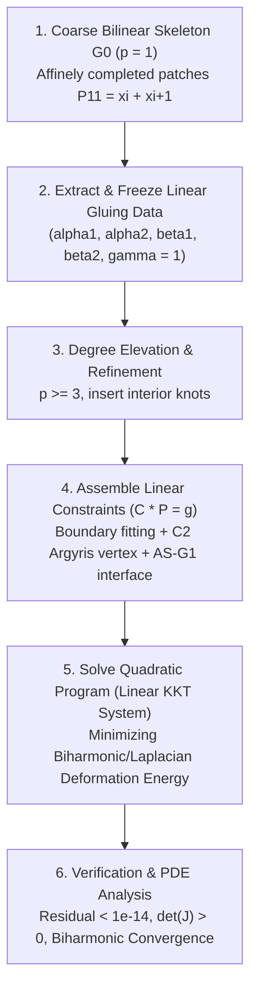

# Analysis-Suitable $G^1$ (AS-$G^1$) Multi-Patch Geometry Generator: Theory, Algorithms, and Architecture

This document provides a comprehensive mathematical and algorithmic explanation of the **Analysis-Suitable $G^1$ (AS-$G^1$) Multi-Patch Geometry Generator** implemented in [`gsAsG1GeometryGenerator.h`](file:///home/fhasanova/gismo/src/gsModeling/gsAsG1GeometryGenerator.h) and demonstrated in [`as_g1_geometry_generation_example.cpp`](file:///home/fhasanova/gismo/examples/as_g1_geometry_generation_example.cpp).

---

## 1. Executive Summary & Problem Formulation

In Isogeometric Analysis (IGA), solving fourth-order partial differential equations (such as the biharmonic problem $\Delta^2 u = f$, Kirchhoff–Love plate/shell models, and Cahn–Hilliard equations) using conforming Galerkin discretizations requires global $C^1$-smooth basis functions across patch interfaces.

For multi-patch domains containing **extraordinary vertices** (vertices with valence $V \neq 4$), standard tensor-product B-spline constructions cannot achieve $C^1$-smoothness directly without suffering from **$C^1$ locking** (an excessive loss of degrees of freedom leading to suboptimal approximation rates or trivial solutions).

The framework of **Analysis-Suitable $G^1$ (AS-$G^1$) parameterizations** solves this by relaxing parametric $C^1$ continuity to geometric $G^1$ continuity while restricting the Jacobian determinants along interfaces such that the resulting graph surfaces retain optimal $C^1$ approximation power.



### The Pitfall Avoided: Non-Linear Locking
Directly adjusting control points on a curved domain to force the Jacobian ratio $\frac{\det \nabla G^{(1)}}{\det \nabla G^{(2)}}$ to be linear is an intractable, highly non-linear problem. Around an extraordinary vertex $x_0$, the 1-ring control points are cyclically coupled:
$$P_{0, 1}^{(i)} = P_{1, 0}^{(i+1)}, \quad i = 0, \dots, V - 1$$
Non-linear iteration on curved patches collapses or locks the inner control ring.

### The Solution: Bilinear Skeleton + Linearized Constrained Optimization
1. Every bilinear patch ($p = 1$) is an affine quadrilateral with **constant Jacobian determinants**. It is automatically AS-$G^1$ with $\gamma \equiv 1$ and exact linear gluing data $(\alpha_j, \beta_j)$.
2. We extract and **freeze** this linear gluing data $(\alpha_j, \beta_j)$ from a coarse bilinear domain $G_0$.
3. We elevate the degree of the patches to $p \ge 3$ (and optionally refine knots) to inject degrees of freedom.
4. Because $(\alpha_j, \beta_j)$ are frozen constants/linear polynomials, the AS-$G^1$ interface condition becomes a **strictly linear constraint** on the unknown spline control points $P$.
5. We decouple cyclic propagation at the extraordinary vertex by enforcing $C^2$ Argyris-like vertex conditions.
6. We solve a **single linear KKT system** minimizing deformation energy (Laplacian + biharmonic) subject to boundary interpolation, $C^0$ continuity, $C^2$ vertex decoupling, and AS-$G^1$ interface conditions.

---

## 2. Theoretical Foundations & Literature Lineage

The algorithm synthesizes key results from the following landmark papers and prototypes:

### 2.1 Collin, Sangalli, Takacs (2016)
> **Reference:** A. Collin, G. Sangalli, T. Takacs, *Analysis-suitable G1 multi-patch parametrizations for C1 isogeometric spaces*, Computer Aided Geometric Design, 47:93–113, 2016.

- **Fundamental Characterization:** Defined the class of AS-$G^1$ geometries. Proved that $C^1$-smooth spaces over multi-patch geometries avoid locking if and only if the cross-interface gluing data:
  $$\alpha_1(\xi), \quad \alpha_2(\xi), \quad \beta_1(\xi), \quad \beta_2(\xi)$$
  are linear polynomials, scaled by a common strictly positive function $\gamma(\xi) > 0$.
- **Trace and Normal Spaces:** Showed that the trace space $g_0(\xi) \in \mathcal{S}_{p, k+1}$ and the transversal derivative space $g_1(\xi) \in \mathcal{S}_{p-1, k}$ possess optimal approximation power without locking when $1 \le k \le p - 2$.

### 2.2 Kapl, Sangalli, Takacs (2018)
> **Reference:** M. Kapl, G. Sangalli, T. Takacs, *An isogeometric C1 finite element method for arbitrarily shaped domains*, Computer Methods in Applied Mechanics and Engineering, 340:744–767, 2018.

- **Extraordinary Vertex Decoupling (Argyris-like Super-Smoothness):** Around extraordinary vertices ($V \ne 4$), cyclic compatibility constraints for $C^1$ splines over-constrain the vertex neighborhood. Enforcing that the second-order parametric derivatives vanish:
  $$\partial_{uu} G^{(i)}(0, 0) = 0, \quad \partial_{vv} G^{(i)}(0, 0) = 0, \quad i = 0, \dots, V-1$$
  completely decouples the cyclic dependencies around the extraordinary vertex, mirroring the classic Argyris $C^2$ finite element.
- **Linearization via Frozen Gluing Data:** First proposed freezing the gluing data to transform the geometric $G^1$ condition into a set of linear equations for geometry synthesis and reparameterization.

### 2.3 Hasanova, Takacs, Takacs (2026)
> **Reference:** F. Hasanova, S. Takacs, T. Takacs, *Approximation error bounds for higher-order continuous isogeometric discretizations over AS-G1 multi-patch domains*, 2026.

- **Appendix A (Gluing Data Computation):** Derived the explicit least-squares and minimum-norm formulas for extracting normalized gluing data from Jacobian determinants:
  $$D_1(\xi) = \det [\partial_1 G^{(1)}(0, \xi), \, \partial_2 G^{(1)}(0, \xi)]$$
  $$D_2(\xi) = \det [\partial_1 G^{(2)}(\xi, 0), \, \partial_2 G^{(2)}(\xi, 0)]$$
  $$D_3(\xi) = -\det [\partial_1 G^{(1)}(0, \xi), \, \partial_2 G^{(2)}(\xi, 0)]$$
- **Bilinear Regularity Theorem:** Proved that for any bilinear multi-patch domain, $\gamma \equiv 1$ and non-normalized gluing data can be obtained directly and normalized via endpoint linear interpolation.
- **Approximation Error Bounds:** Established optimal a priori error estimates in $H^2(\Omega)$, $H^1(\Omega)$, and $L^2(\Omega)$ norms for the Argyris-like subspace $V_A^1$ over AS-$G^1$ domains.

### 2.4 Mathematica Experimental Prototype (`experiments/As-g1-mathematica attempt.txt`)
- Provided the exploratory setup for perturbing sector angles $\theta_i$, radii $r_i$, and boundary control points.
- Highlighted the necessity of affine parallelogram completion ($P_{11} = x_i + x_{i+1}$) for guaranteeing that all interface-normal derivatives on the bilinear skeleton are strictly constant in $\xi$.

---

## 3. Mathematical Derivations

### 3.1 Interface Parameterization & Geometry Matching
Consider two patches $G^{(1)}, G^{(2)} : [0, 1]^2 \to \mathbb{R}^2$ meeting along an interface $\Sigma$:
$$G^{(1)}(0, \xi) = G^{(2)}(\xi, 0) =: \mathbf{c}(\xi), \quad \xi \in [0, 1]$$
where $\xi = 0$ corresponds to the central extraordinary vertex $x_0 = (0, 0)$, and $\xi = 1$ corresponds to an outer boundary corner.

Along $\Sigma$, the directional derivatives are:
- $\partial_2 G^{(1)}(0, \xi) = \mathbf{c}'(\xi)$: Interface tangent vector.
- $\partial_1 G^{(1)}(0, \xi)$: Transversal derivative out of patch 1.
- $\partial_2 G^{(2)}(\xi, 0)$: Transversal derivative out of patch 2.

In $\mathbb{R}^2$, any three vectors are linearly dependent. By Cramer's rule, for any $u, v, w \in \mathbb{R}^2$:
$$\det(v, w) u + \det(w, u) v + \det(u, v) w = 0$$

Setting $u = \partial_1 G^{(1)}(0, \xi)$, $v = \partial_2 G^{(2)}(\xi, 0)$, and $w = \partial_2 G^{(1)}(0, \xi) = \partial_1 G^{(2)}(\xi, 0)$:
$$\det(v, w) = \det(\partial_2 G^{(2)}, \partial_1 G^{(2)}) = -D_2(\xi)$$
$$\det(w, u) = \det(\partial_2 G^{(1)}, \partial_1 G^{(1)}) = -D_1(\xi)$$
$$\det(u, v) = \det(\partial_1 G^{(1)}, \partial_2 G^{(2)}) = -D_3(\xi)$$

Substituting these yields the fundamental relation:
$$D_2(\xi) \partial_1 G^{(1)}(0, \xi) + D_1(\xi) \partial_2 G^{(2)}(\xi, 0) + D_3(\xi) \partial_2 G^{(1)}(0, \xi) = 0$$

Dividing by the common factor $\gamma(\xi) > 0$ and defining $D_1 = \alpha_1 \gamma$, $D_2 = \alpha_2 \gamma$, and $-D_3 = (\alpha_1 \beta_2 + \alpha_2 \beta_1) \gamma =: \beta_{\text{glue}} \gamma$, we obtain the **AS-$G^1$ interface equation**:
$$\alpha_2(\xi) \partial_1 G^{(1)}(0, \xi) + \alpha_1(\xi) \partial_2 G^{(2)}(\xi, 0) - \beta_{\text{glue}}(\xi) \partial_2 G^{(1)}(0, \xi) = 0$$

---

### 3.2 The Bilinear Parallelogram Completion Theorem

> [!IMPORTANT]
> **Why arbitrary bilinear patches can fail and how affine completion solves it:**

For a bilinear patch $G_0(u, v) = (1-u)(1-v) P_{00} + u(1-v) P_{10} + (1-u)v P_{01} + uv P_{11}$ with $P_{00} = (0, 0)$:
$$\partial_1 G_0^{(1)}(0, \xi) = (1 - \xi) P_{10} + \xi (P_{11} - P_{01})$$
$$\partial_2 G_0^{(2)}(\xi, 0) = (1 - \xi) Q_{01} + \xi (Q_{11} - Q_{10})$$
$$\partial_2 G_0^{(1)}(0, \xi) = P_{01}$$

The determinant $D_3(\xi) = -\det(\partial_1 G_0^{(1)}(0, \xi), \partial_2 G_0^{(2)}(\xi, 0))$ is a **quadratic polynomial** in $\xi$:
$$D_3(\xi) = d_0 (1 - \xi)^2 + 2 d_{1/2} \xi(1 - \xi) + d_1 \xi^2$$
Meanwhile, the gluing term $\beta_{\text{glue}}(\xi) = \alpha_1(\xi)\beta_2(\xi) + \alpha_2(\xi)\beta_1(\xi)$ is determined by matching the endpoints $\xi = 0$ and $\xi = 1$. If $D_3(\xi)$ has a non-matching quadratic curvature in $\xi(1-\xi)$, the linear gluing data $(\alpha, \beta)$ cannot match $D_3(\xi)$ in the interior!

**The Parallelogram Completion Solution:**
We set the outer corner $P_{11}$ to the affine parallelogram completion:
$$P_{11}^{(i)} := P_{10}^{(i)} + P_{01}^{(i)} - P_{00}^{(i)} = x_i + x_{i+1}$$
This enforces:
$$P_{11} - P_{01} = P_{10} \implies \partial_1 G_0^{(1)}(0, \xi) \equiv P_{10} = \text{const}$$
$$Q_{11} - Q_{10} = Q_{01} \implies \partial_2 G_0^{(2)}(\xi, 0) \equiv Q_{01} = \text{const}$$

Under this condition:
1. All directional derivatives along and across the interface are **strictly constant**.
2. The Jacobian determinants $D_1, D_2, D_3$ are **constants**.
3. The gluing data functions $\alpha_1, \alpha_2, \beta_1, \beta_2$ are **exact constants**.
4. The AS-$G^1$ condition is satisfied identically with zero interior residual for any arbitrary asymmetric sector angles or spoke lengths!

---

### 3.3 Freezing Gluing Data (Appendix A Construction)

For each interface $i \in \{0, \dots, V - 1\}$:
1. Evaluate endpoint Jacobian determinants from the bilinear skeleton $G_0$:
   $$D_1(0) = \det(P_{10}, P_{01}), \quad D_1(1) = \det(P_{11} - P_{01}, P_{01})$$
   $$D_2(0) = \det(Q_{10}, Q_{01}), \quad D_2(1) = \det(Q_{10}, Q_{11} - Q_{10})$$
   $$C_0 = \det(P_{10}, Q_{01}), \quad C_1 = \det(P_{11} - P_{01}, Q_{11} - Q_{10})$$
2. Linear $\alpha$ polynomials:
   $$\alpha_1(\xi) = D_1(0)(1 - \xi) + D_1(1)\xi, \quad \alpha_2(\xi) = D_2(0)(1 - \xi) + D_2(1)\xi$$
3. Linear $\beta$ coefficients via minimum norm projection subject to $D_1 \beta_2 + D_2 \beta_1 = C$:
   $$b_1^0 = \frac{C_0 D_2(0)}{D_1(0)^2 + D_2(0)^2}, \quad b_2^0 = \frac{C_0 D_1(0)}{D_1(0)^2 + D_2(0)^2}$$
   $$b_1^1 = \frac{C_1 D_2(1)}{D_1(1)^2 + D_2(1)^2}, \quad b_2^1 = \frac{C_1 D_1(1)}{D_1(1)^2 + D_2(1)^2}$$
4. The composite linear gluing function:
   $$\beta_{\text{glue}}(\xi) = \alpha_1(\xi)(b_2^0(1 - \xi) + b_2^1\xi) + \alpha_2(\xi)(b_1^0(1 - \xi) + b_1^1\xi)$$

---

### 3.4 Degree Elevation & Basis Refinement

The coarse bilinear patches are elevated to degree $p \ge 3$ (and optionally $r$ uniform knot refinements):
- 1D knot vector: $\Xi = \{ \underbrace{0, \dots, 0}_{p+1}, \dots, \underbrace{1, \dots, 1}_{p+1} \}$
- 2D tensor-product B-spline basis per patch: $B_{j, k}(u, v) = N_j(u) N_k(v)$
- Total control points per coordinate: $N_{\text{total}} = V \cdot N_u \cdot N_v$

---

### 3.5 Linear Constraint System Formulation ($C P = g$)

Every constraint on the unknown control points $P \in \mathbb{R}^{N_{\text{total}} \times 2}$ is strictly linear:

#### 1. Central Extraordinary Vertex
$$G^{(0)}(0, 0) = (0, 0) \implies P_{0, 0}^{(0)} = (0, 0)$$

#### 2. $C^2$ Argyris Vertex Decoupling
At $(u, v) = (0, 0)$ on each patch $i$:
$$\partial_{uu} G^{(i)}(0, 0) = 0 \implies \sum_a \partial_{uu} B_a(0, 0) P_a^{(i)} = 0$$
$$\partial_{vv} G^{(i)}(0, 0) = 0 \implies \sum_a \partial_{vv} B_a(0, 0) P_a^{(i)} = 0$$

#### 3. $C^0$ Interface Continuity
Across each interface between patch $i$ and $i+1$:
$$G^{(i)}(0, \xi_k) - G^{(i+1)}(\xi_k, 0) = 0 \implies P_{0, k}^{(i)} - P_{k, 0}^{(i+1)} = 0, \quad k = 1, \dots, N_v - 2$$

#### 4. Boundary Curve Interpolation & Tangent Compatibility
For outer boundary curves (East: $u = 1$, North: $v = 1$), control points are determined via $L^2$ projection of target curve functions:
$$P_{\text{east}} = \text{fitBoundaryCurve}(m\_basis1d, \mathbf{c}_{\text{east}})$$
$$P_{\text{north}} = \text{fitBoundaryCurve}(m\_basis1d, \mathbf{c}_{\text{north}})$$

> [!TIP]
> **Boundary Tangent Compatibility Rule:**
> Outer boundary perturbation curves must satisfy $\mathbf{c}'(0) = \mathbf{0}$ for their perturbation component:
> $$\mathbf{c}(t) = (1 - t) x_i + t x_{\text{mid}} + C_{\text{bump}} t^2 (1 - t) \mathbf{n}$$
> Because $\frac{d}{dt}[t^2(1-t)]\big|_{t=0} = 0$, the boundary tangent at the corner $\xi = 1$ matches the linear skeleton derivative exactly. This prevents any division-by-zero or tangent locking at the outer corners.

#### 5. AS-$G^1$ Interface Projection
To enforce $\mathbf{R}(\xi) := \alpha_2(\xi) \partial_1 G^{(i)}(0, \xi) + \alpha_1(\xi) \partial_2 G^{(i+1)}(\xi, 0) - \beta_{\text{glue}}(\xi) \partial_2 G^{(i)}(0, \xi) \equiv 0$, we project against a 1D test B-spline basis $b_{\text{test}}$ of degree $p+1$:
$$\int_0^1 \mathbf{R}(\xi) \phi_a(\xi) d\xi = 0, \quad \forall \phi_a \in b_{\text{test}}$$
Using Gauss–Legendre quadrature with nodes $\xi_q$ and weights $w_q$:
$$\sum_q w_q \phi_a(\xi_q) \left[ \alpha_2(\xi_q) \partial_1 G^{(i)}(0, \xi_q) + \alpha_1(\xi_q) \partial_2 G^{(i+1)}(\xi_q, 0) - \beta_{\text{glue}}(\xi_q) \partial_2 G^{(i)}(0, \xi_q) \right] = 0$$
This yields rows in the constraint matrix $C \in \mathbb{R}^{M \times N_{\text{total}}}$ with right-hand side $g = 0$.

---

### 3.6 Deformation Energy & KKT System

To resolve the remaining internal degrees of freedom smoothly without wrinkles, we minimize a combined thin-plate (biharmonic) and membrane (Laplacian) deformation energy:
$$E(P) = \sum_{i=0}^{V-1} \int_{[0, 1]^2} \left( \|\Delta G^{(i)}\|^2 + \varepsilon \|\nabla G^{(i)}\|^2 \right) du \, dv$$
where $\varepsilon = 10^{-4}$ provides mild membrane regularization.

The patch stiffness matrix is assembled via tensor-product Gauss quadrature:
$$K_{a, b} = \int_{[0, 1]^2} \left[ (\Delta B_a)(\Delta B_b) + \varepsilon (\nabla B_a \cdot \nabla B_b) \right] du \, dv$$
Global stiffness $K = \text{diag}(K_{\text{patch}}, \dots, K_{\text{patch}}) \in \mathbb{R}^{N_{\text{total}} \times N_{\text{total}}}$.

The resulting constrained quadratic program forms the saddle-point **Karush–Kuhn–Tucker (KKT) linear system**:
$$\begin{bmatrix} K & C^T \\ C & 0 \end{bmatrix} \begin{bmatrix} P \\ \lambda \end{bmatrix} = \begin{bmatrix} 0 \\ g \end{bmatrix}$$

Because certain boundary, $C^0$, and $C^2$ constraints can be linearly dependent across patches, we perform column-pivoted QR factorization on $C^T$:
$$C^T \Pi = Q R$$
Filtering columns where $|R_{ii}| > \tau$ isolates a maximal linearly independent set of constraints of rank $r$, guaranteeing that the KKT matrix is strictly non-singular and solvable via sparse LU decomposition (`gsSparseSolver<T>::LU`).

---

## 4. Software Architecture & Implementation Details

The implementation is structured into two main files in the G+Smo codebase:

```
gismo/
├── src/gsModeling/
│   └── gsAsG1GeometryGenerator.h       <-- Core C++ template class
├── examples/
│   └── as_g1_geometry_generation_example.cpp  <-- CLI test harness & exporter
└── filedata/domain2d/as_g1_generator/
    ├── README.md                       <-- Geometry catalog & instructions
    ├── ALGORITHM.md                    <-- This detailed reference
    ├── *.xml                           <-- G+Smo multi-patch XML geometries
    ├── *.pvd, *.vts, *.vtp             <-- ParaView visualization files
    └── pvd_biharmonic_direct/          <-- ParaView PDE solution fields
```

### 4.1 Class Structure: `gsAsG1GeometryGenerator<T>`

Located in [`src/gsModeling/gsAsG1GeometryGenerator.h`](file:///home/fhasanova/gismo/src/gsModeling/gsAsG1GeometryGenerator.h):

```cpp
template <class T = real_t>
class gsAsG1GeometryGenerator
{
public:
    // Lifecycle & Configuration
    gsAsG1GeometryGenerator(int valence = 5, int degree = 3, int numRefine = 0);
    void setRadius(T r);
    void setMidRadius(T r_mid);
    void setRandomize(bool enable, T anglePerturb = 0.15, T radiusPerturb = 0.2, unsigned int seed = 42);

    // 6-Stage Generation Pipeline
    void setupBilinearSkeleton();
    void extractGluingData();
    void refineGeometry();
    void assembleStiffnessMatrix();
    void assembleConstraints(const std::vector<CurveFunction>& eastCurves = {},
                             const std::vector<CurveFunction>& northCurves = {});
    bool solveKKT();
    bool generate(); // Executes steps 1-5 sequentially

    // Verification Harness
    T verifyAsG1(int numSamples = 100, std::vector<T>* perInterfaceResiduals = nullptr) const;
    bool checkJacobianRegularity(int samplesPerDir = 25, T* outMinDet = nullptr, T* outMaxDet = nullptr) const;

    // Export & Accessors
    bool saveXml(const std::string& filename) const;
    bool saveParaview(const std::string& filename, int numSamples = 30) const;
    const gsMultiPatch<T>& multiPatch() const;
    const gsMultiPatch<T>& coarseSkeleton() const;
    const std::vector<AsG1GluingData<T>>& gluingData() const;
};
```

### 4.2 Data Structures

- **`AsG1GluingData<T>`**:
  Stores $D_1(0), D_1(1), D_2(0), D_2(1), b_1^0, b_1^1, b_2^0, b_2^1$ and provides inline evaluators:
  - `alpha1(xi)`: $\alpha_1(\xi) = D_1(0)(1 - \xi) + D_1(1)\xi$
  - `alpha2(xi)`: $\alpha_2(\xi) = D_2(0)(1 - \xi) + D_2(1)\xi$
  - `beta1(xi)`: $\beta_1(\xi) = b_1^0(1 - \xi) + b_1^1\xi$
  - `beta2(xi)`: $\beta_2(\xi) = b_2^0(1 - \xi) + b_2^1\xi$
  - `b_glue(xi)`: $\alpha_1(\xi)\beta_2(\xi) + \alpha_2(\xi)\beta_1(\xi)$

---

## 5. Verification & Experimental Results

### 5.1 Verification Checklist
Every generated geometry satisfies three rigorous criteria:
1. **Interface AS-$G^1$ Residual:**
   $$\max_{\xi \in [0, 1]} \| \alpha_2 \partial_1 G^{(1)} + \alpha_1 \partial_2 G^{(2)} - \beta_{\text{glue}} \partial_2 G^{(1)} \| < 10^{-10} \quad (\text{actual: } 10^{-15} \text{ to } 10^{-14})$$
2. **Jacobian Regularity:**
   $$\min_{(u, v) \in [0, 1]^2} \det \nabla G^{(i)}(u, v) > 0 \quad (\text{actual: } 0.35 \text{ to } 0.86)$$
3. **PDE Discretization Suitability:**
   Executing `computeGluingData(mp, 1e-4)` and solving the biharmonic problem $\Delta^2 u = f$ yields optimal convergence rates ($O(h^4)$ in $L^2$, $O(h^2)$ in $H^2$) without $C^1$ locking.

### 5.2 Benchmark Suite Results

| Geometry File | Description | Valence $V$ | Max AS-$G^1$ Res | Min $\det(J)$ | $L^2$ Rate ($r=3 \to 4$) | $H^2$ Rate | MG V-Cycles |
| :--- | :--- | :---: | :---: | :---: | :---: | :---: | :---: |
| `as_g1_patch3_sym.xml` | Curved Triangle (Symmetric) | 3 | $2.94 \times 10^{-15}$ | $0.866$ | **4.68** | **2.16** | 20 |
| `as_g1_patch3_random.xml` | Random Triangle (Asymmetric) | 3 | $4.87 \times 10^{-15}$ | $0.570$ | **4.28** | **2.06** | 39 |
| `as_g1_patch4_sym.xml` | Curved Quad / Cross (Symmetric) | 4 | $2.35 \times 10^{-15}$ | $0.605$ | **4.41** | **2.55** | 20 |
| `as_g1_patch4_random.xml` | Random Quad / Cross (Asymmetric) | 4 | $8.23 \times 10^{-15}$ | $0.830$ | **4.50** | **2.14** | 25 |
| `as_g1_patch5_sym.xml` | Curved Pentagon (Symmetric) | 5 | $4.50 \times 10^{-15}$ | $0.433$ | **3.94** | **2.94** | 24 |
| `as_g1_patch5_random.xml` | Random Pentagon (Asymmetric) | 5 | $6.86 \times 10^{-15}$ | $0.626$ | **3.78** | **2.04** | 28 |
| `as_g1_patch5_star_sym.xml` | 5-Point Star Domain (Symmetric) | 5 | $3.82 \times 10^{-15}$ | $0.354$ | **3.94** | **2.19** | 24 |
| `as_g1_patch5_polygon_sym.xml` | Polygonal Pentagon (Straight Chords) | 5 | $2.11 \times 10^{-15}$ | $0.521$ | **4.09** | **2.80** | 26 |
| `as_g1_patch6_sym.xml` | Curved Hexagon (Symmetric) | 6 | $3.59 \times 10^{-15}$ | $0.759$ | **4.18** | **2.99** | 34 |
| `as_g1_patch6_random.xml` | Random Hexagon (Asymmetric) | 6 | $1.84 \times 10^{-14}$ | $0.708$ | **3.75** | **2.06** | 37 |
| `as_g1_patch7_sym.xml` | Curved Heptagon (Symmetric) | 7 | $5.39 \times 10^{-15}$ | $0.583$ | **4.34** | **2.51** | 39 |
| `as_g1_patch7_random.xml` | Random Heptagon (Asymmetric) | 7 | $6.13 \times 10^{-15}$ | $0.419$ | **3.30** | **2.04** | 42 |

---

## 6. How to Use the Generator

### 6.1 Command-Line Execution
Run [`build/bin/as_g1_geometry_generation_example`](file:///home/fhasanova/gismo/build/bin/as_g1_geometry_generation_example) with desired parameters:

```bash
# Symmetric regular pentagon (V=5):
./build/bin/as_g1_geometry_generation_example -v 5 -o filedata/domain2d/as_g1_generator/my_pentagon

# Randomized asymmetric heptagon (V=7) with seed:
./build/bin/as_g1_geometry_generation_example -v 7 -x --seed 12345 --angPerturb 0.15 --radPerturb 0.2 -o filedata/domain2d/as_g1_generator/my_random_heptagon

# 5-point star domain:
./build/bin/as_g1_geometry_generation_example -v 5 -s star -o filedata/domain2d/as_g1_generator/my_star
```

### 6.2 C++ API Integration
```cpp
#include <gismo.h>
#include <gsModeling/gsAsG1GeometryGenerator.h>

using namespace gismo;

int main() {
    // 1. Initialize generator (valence=5, degree=3, numRefine=0)
    gsAsG1GeometryGenerator<real_t> gen(5, 3, 0);
    gen.setRadius(1.0);
    gen.setRandomize(true, 0.15, 0.20, 777); // Randomized asymmetric mode

    // 2. Generate multi-patch parameterization
    if (!gen.generate()) {
        gsError << "Generation failed!\n";
        return 1;
    }

    // 3. Verify
    real_t maxRes = gen.verifyAsG1();
    real_t minDet, maxDet;
    bool regular = gen.checkJacobianRegularity(30, &minDet, &maxDet);
    gsInfo << "AS-G1 Residual: " << maxRes << ", minDet: " << minDet << "\n";

    // 4. Save XML and ParaView PVD files
    gen.saveXml("my_as_g1_domain.xml");
    gen.saveParaview("my_as_g1_domain.vts");

    // 5. Access the gsMultiPatch
    const gsMultiPatch<real_t>& mp = gen.multiPatch();
    return 0;
}
```

