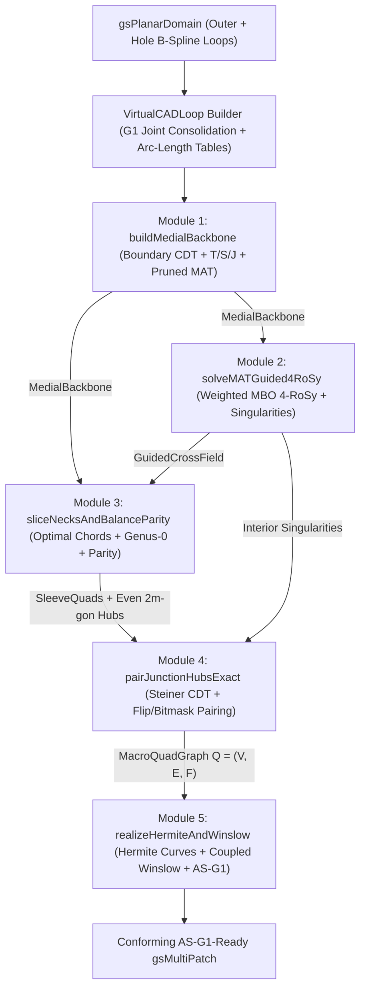

# Field-Guided Medial Macro-Pairing (`Merged` Algorithm) — Feasibility & Implementation Plan

## 1. Feasibility Assessment Against Current `gsModeling` Codebase

**Verdict: Strongly feasible — roughly 70–75% of the low-level geometric, PDE, topological, and spline primitives already exist in `src/gsModeling/`, and zero new third-party dependencies are required.**

Right now, [gsPatchSplitter.h](file:///home/fhasanova/gismo/src/gsModeling/gsPatchSplitter.h) runs MAT, Cross-Field, and CDT/Blossom as *separate, competing monolithic pipelines* — and each exhibits the exact standalone failure mode identified in the proposal:

| Proposed Module | Existing Reusable Primitives in `src/gsModeling/` | What Must Be Built / Adapted |
| :--- | :--- | :--- |
| **Module 1: Boundary CDT & Pruned MAT** | `buildVirtualCADLoops` ([gsPatchSplitterMotorcycle.hpp](file:///home/fhasanova/gismo/src/gsModeling/gsPatchSplitterMotorcycle.hpp#L159-L248)); `buildConstrainedDomainTriangulation` & `applyDomainLawsonFlips` ([gsPatchSplitterTriMesh.hpp](file:///home/fhasanova/gismo/src/gsModeling/gsPatchSplitterTriMesh.hpp#L161-L800)); `T/S/J` classification, circumcenter/radius `MATNode`, $\theta$-SMA leaf pruning, `J-J` cluster contraction, and `MacroBranch` chord extraction ([gsPatchSplitterMAT.hpp](file:///home/fhasanova/gismo/src/gsModeling/gsPatchSplitterMAT.hpp#L583-L1355)). | Decouple `gsPatchSplitterMAT` after `Step 1.4` into a clean `MedialBackbone<T>` data product (discarding `Step 1.6`, which turns skeleton curves into 2-layer interfaces), anchor boundary vertices on `VirtualCADLoop<T>` arc-length coordinates `(loopIdx, arcS)`, and explicitly tag terminal $n_q = 1$ sharp tips. |
| **Module 2: MAT-Guided 4-RoSy Cross-Field** | `refineInteriorTriangles`, `CrossFieldMeshAccel<T>` ($O(1)$ triangle walk), `solveHarmonic4RoSy` ([gsPatchSplitterCrossField.hpp](file:///home/fhasanova/gismo/src/gsModeling/gsPatchSplitterCrossField.hpp#L31-L459)), and Robin-regularized MBO solver + dipole pruning `solveRegularized4RoSy` ([gsPatchSplitterMotorcycle.hpp](file:///home/fhasanova/gismo/src/gsModeling/gsPatchSplitterMotorcycle.hpp#L382-L600)). | Add SPD MAT-sleeve alignment energy on narrow parallel channels (using $z_{\text{MAT}} = (\tau_x + i\tau_y)^4$, which is invariant under $\pi/2$ rotation between MAT tangent and normal), zeroed inside $n_q = 1$ converging tips and wide junctions; filter singularities $\{s_i\}$ strictly into junction hubs. |
| **Module 3: Optimal Neck Slicing & Parity** | `evalCrossFieldAt`, `projectPointToVirtualLoop`, `extractVirtualSubCurve` ([gsPatchSplitterMotorcycle.hpp](file:///home/fhasanova/gismo/src/gsModeling/gsPatchSplitterMotorcycle.hpp#L135-L310)), and exact rational/integer quantization helpers (`TMeshRat` in [gsPatchSplitterMotorcycle.hpp](file:///home/fhasanova/gismo/src/gsModeling/gsPatchSplitterMotorcycle.hpp#L3068-L3100)). | **New core glue (~450 LOC):** continuous/discrete optimization of cross-cut functional $J(\gamma)$ across MAT sleeve corridors, hole-cycle spanning/degree-$\ge 2$ enforcement (so every junction region $P_j$ is strictly genus-0 and non-self-touching), and 1-layer-preserving boundary-wall parity balancing ($B(P_j) = 2m_j$). |
| **Module 4: Singularity-Seeded Macro-Pairing** | `splitEvenFaceToQuadsRecursive` ([gsPatchSplitterCrossField.hpp](file:///home/fhasanova/gismo/src/gsModeling/gsPatchSplitterCrossField.hpp#L538-L651)), `evalMeshQuadUnion`, `flipForBetterQuadUnions`, and `augmentBlossomMatchingFrom` ([gsPatchSplitterTriMesh.hpp](file:///home/fhasanova/gismo/src/gsModeling/gsPatchSplitterTriMesh.hpp#L1786-L2171)). | **New core finisher (~450 LOC):** Steiner triangulation of $2m_j$-gon $P_j \cup \{s_1,\dots,s_I\}$ ($N_{\text{tri}} = 2(m_j + I - 1) \le 16$) coupled with **joint diagonal-flip + exact bitmask branch-and-bound pairing** (eliminating $K_{1,3}$ dual-claw deadlocks) and local $\{s_i\}$ position smoothing. |
| **Module 5: Hermite Curves + Winslow $\to$ AS-$G^1$** | `makeSymmetricHermiteSpoke` ([gsPatchSplitterTriMesh.hpp](file:///home/fhasanova/gismo/src/gsModeling/gsPatchSplitterTriMesh.hpp#L2024-L2055)), `makeCoonsFromCCWCycle`, `optimizeWinslowBarrier`, moving-interface `optimizeCoupledInterfacesAndInteriors` ([gsPatchSplitter.hpp](file:///home/fhasanova/gismo/src/gsModeling/gsPatchSplitter.hpp#L5364-L5904)), `formatForArgyris` ([gsPatchSplitterPolychord.hpp](file:///home/fhasanova/gismo/src/gsModeling/gsPatchSplitterPolychord.hpp#L1581-L1732)), and `gsASG1LocalFitter<T>` ([gsASG1LocalFitter.h](file:///home/fhasanova/gismo/src/gsModeling/gsASG1LocalFitter.h)). | Enforce cross-field port tangents ($2\pi/\operatorname{val}(v)$ at EVs, $90^\circ$ inward normal at smooth $\partial\Omega$) during Hermite curve construction, and add a soft endpoint-tangent penalty on `chain[1]` / `chain[nc-2]` inside `optimizeCoupledInterfacesAndInteriors` so interface smoothing preserves $\beta(0) \approx 0$ at boundaries. |

---

## 2. Critical Mathematical Invariants & Edge Cases Addressed in This Plan

> [!IMPORTANT]
> Four subtle topological and geometric invariants must be enforced in code for the theoretical guarantees of Modules 2–4 to hold on arbitrary multi-hole curved B-Rep domains:

1. **$n_q = 1$ Converging Tip Exclusion in Module 2:**  
   Along a parallel sleeve of width $2r$, both walls share the same 4-RoSy target $z_{\text{MAT}} = e^{i4\phi_{\text{MAT}}}$. Inside a sharp tapering blade tip ($\omega < 65^\circ$, $n_q = 1$), $r(x) \to 0$ as well, *but* the two walls converge at angle $\omega \neq 0$, so forcing $z \to z_{\text{MAT}}$ fights boundary clamping. Thus the MAT alignment weight $w_{\text{MAT}}(x)$ must be gated by wall anti-parallelism ($\cos\angle(\tau_L, -\tau_R) > 0.7$) and zeroed inside terminal $n_q = 1$ ears.
2. **Genus-0 & Non-Self-Touching Guarantee on Every Junction Polygon $P_j$ (Module 3):**  
   Euler's formula $N_{\text{tri}} = 2m_j + 2I - 2$ holds **if and only if** $P_j$ is topologically a disk (zero uncut interior holes) and has no degree-1 slit cuts. In the multigraph whose nodes are boundary loops $\{L_0, L_1, \dots, L_H\}$ and whose edges are placed cross-cuts $\{\gamma_k\}$:
   - Cross-cuts must connect $\{L_0, \dots, L_H\}$ into a single connected component (opening all annuli).
   - Every hole loop $L_h$ ($h \ge 1$) must have **at least 2 incident cross-cuts** (and on smooth holes, enough cuts so each hole arc turns by at most $\sim 135^\circ$, e.g. 4 cuts on an isolated central hole cycle), preventing self-touching wrap-around patches.
3. **Preserving 1-Layer Bridges During Parity Balancing (Module 3):**  
   Splitting an interior sleeve cross-cut $\gamma_k$ ($k_\gamma = 2$) would force a longitudinal split through the entire adjacent sleeve strip, re-introducing a **2-patch-thick bridge**! Instead, because $\mathcal{T}_0$ is a boundary-only CDT and cross-cuts step slightly back from junctions, virtually every $P_j$ contains smooth exterior/hole boundary wall arcs $w \subset \partial P_j \cap \partial\Omega$. Splitting a boundary wall arc $w$ ($k_w \in \{1, 2, 3\}$) changes $B(P_j)$ **for $P_j$ alone**, keeping $k_\gamma \equiv 1$ on all cross-cuts and guaranteeing 1-layer bridges everywhere. (A tiny exact GF(2)/0-1 solver over sleeve longitudinal splits is kept strictly as a fallback for the rare case of a fully interior-locked junction with zero exposed boundary arcs.)
4. **Eliminating $K_{1,3}$ Dual-Claw Deadlocks in Macro-Pairing (Module 4):**  
   Even-count triangulations ($N_{\text{tri}} = 2(m_j + I - 1)$) do **not** automatically admit a perfect matching in their fixed dual graph (e.g., a 6-gon with $I=0$ triangulated as 1 central triangle + 3 ear triangles has $N_{\text{tri}} = 4$ but dual graph $K_{1,3}$, leaving 2 ears unmatched). Because $N_{\text{tri}} \le 16$, Module 4 searches **jointly over local Lawson/convex diagonal flips and exact bitmask triangle pairings** (and uses direct DP chord quadrangulation when $I = 0$).

---

## 3. Pipeline Architecture & Decoupled Data Contracts

We introduce a dedicated header [gsPatchSplitterMerged.hpp](file:///home/fhasanova/gismo/src/gsModeling/gsPatchSplitterMerged.hpp) (under `namespace gismo::internal_splitter`) exposing five pure stage functions connected by explicit data structs:



### Core Data Contracts in `gsPatchSplitterMerged.hpp`

```cpp
namespace gismo {
namespace internal_splitter {

// Module 1 Output
template <class T>
struct MedialBackbone {
    std::vector<VirtualCADLoop<T>> vloops;   // G1-consolidated loops with arc-length tables & pinned corners
    TriMeshData<T> cdt;                      // Boundary-only CDT T_0
    std::vector<int> vLoopIdx;               // Per CDT vertex: loop index in vloops
    std::vector<T>   vArcS;                  // Per CDT vertex: arc-length coordinate on vloops[l]
    std::vector<typename gsPatchSplitterMAT<T>::MATNode>     triNodes;
    std::vector<typename gsPatchSplitterMAT<T>::MacroNode>   macroNodes;
    std::vector<typename gsPatchSplitterMAT<T>::MacroBranch> sleeves; // Pruned sleeves + pure hole cycles
    std::vector<bool> isSharpTipTri;         // True on unpruned n_q = 1 ear chains (protected from slicing)
    T domDiag = T(1);
};

// Module 2 Output
template <class T>
struct GuidedCrossField {
    TriMeshData<T> fineMesh;                 // Lightly refined T_0 (2-4 tris across channels)
    CrossFieldMeshAccel<T> accel;            // O(1) barycentric walk accelerator
    CrossFieldSolution<T> field;             // Complex 4-RoSy z(x) + singularities {s_i} + portAngles
    std::vector<T> vertMATRadius;            // Interpolated r(x) on fineMesh vertices
    std::vector<T> vertSleeveWeight;         // Smooth alignment weight w_MAT(x)
};

// Module 3 Output
template <class T>
struct CrossCut {
    int id = -1;
    int sleeveIdx = -1;
    int loopA = -1, loopB = -1;
    T arcSA = T(0), arcSB = T(0);            // Exact footpoints on vloops[loopA], vloops[loopB]
    gsPoint2D<T> ptA, ptB;
    CurveSeg<T> curve;                       // Initialized straight or cross-field Hermite chord A -> B
    int subdiv = 1;                          // Fixed to 1 unless interior-locked fallback triggers
};

template <class T>
struct JunctionPolygon {
    int id = -1;
    struct Side {
        bool isCrossCut = false;
        int cutId = -1;                      // If isCrossCut: index in SlicedDecomposition::cuts
        bool cutForward = true;              // True: ptA -> ptB, False: ptB -> ptA
        int loopIdx = -1;                    // If boundary wall: index in vloops
        T sStart = T(0), sEnd = T(0);        // Forward arc-length span on vloops[loopIdx]
        CurveSeg<T> seg;                     // Oriented CCW along dP_j
    };
    std::vector<Side> sidesCCW;              // Guaranteed even size B(P_j) = 2*m_j >= 4
    std::vector<int> singularityIds;         // Indices into GuidedCrossField::field.singularities inside P_j
};

template <class T>
struct SlicedDecomposition {
    std::vector<CrossCut<T>> cuts;
    std::vector<std::array<CurveSeg<T>, 4>> sleeveQuads; // Finished 1-patch-wide channel/bridge/tip quads
    std::vector<JunctionPolygon<T>> hubs;                // Simply-connected, even-sided junction polygons
};

// Module 4 Output
template <class T>
struct MacroQuadGraph {
    struct Vertex {
        gsPoint2D<T> pt;
        bool isBoundary = false;
        int loopIdx = -1;
        T arcS = T(0);
        bool isPinnedCorner = false;
        int singularityIdx = -1;             // >= 0 if seeded from CrossField singularity
    };
    struct Edge {
        int u = -1, v = -1;
        bool isBoundary = false;
        CurveSeg<T> seg;                     // Exact CAD sub-curve if boundary; Hermite B-spline if interior
    };
    struct Face {
        std::array<int, 4> v;                // CCW vertex ids
        std::array<int, 4> e;                // CCW edge ids
        std::array<bool, 4> eFwd;            // Orientation of edge e[k] along v[k] -> v[(k+1)%4]
    };
    std::vector<Vertex> verts;
    std::vector<Edge>   edges;
    std::vector<Face>   faces;
};

} // namespace internal_splitter
} // namespace gismo
```

---

## 4. Module-by-Module Implementation Specification

### Module 1: `buildMedialBackbone` (Boundary-Only CDT & Pruned MAT)
1. **G1-Consolidated Boundary Ingestion:** Call `buildVirtualCADLoops(dom, degree, smoothJointTolDeg)` so $C^1/G^1$-smooth spline joints are dissolved and true corners receive `targetPatchValence` $n_q = \max(1, \operatorname{round}(\omega / 90^\circ))$.
2. **Boundary-Only CDT $\mathcal{T}_0$:** Sample boundary points with spacing $h_0 \approx \text{diag}/26$ (preserving all pinned corners exactly), run `buildConstrainedDomainTriangulation` + `applyDomainLawsonFlips` + sliver `J`-triangle diagonal flips (reusing [gsPatchSplitterMAT.hpp](file:///home/fhasanova/gismo/src/gsModeling/gsPatchSplitterMAT.hpp#L585-L666)), and record `(vLoopIdx[v], vArcS[v])` for every CDT vertex.
3. **Pruned MAT Graph Extraction:** Factor out Steps `1.1`, `1.3`, and `1.4` of `gsPatchSplitterMAT` into a shared helper so both legacy `MAT` and `Merged` reuse the exact same $\theta$-SMA hair pruning and short `J-J` cluster contraction without code duplication.
4. **Sharp-Tip Tagging:** Any unpruned leaf sleeve ending at a single pinned convex corner with interior angle $\omega < 115^\circ$ ($n_q = 1$) has its triangles marked in `isSharpTipTri` so Module 2 suppresses MAT-tangent forcing there and Module 3 caps the tip directly as a single unsplit curved quad.

### Module 2: `solveMATGuided4RoSy` (MAT-Guided Cross-Field & Singularity Oracle)
1. **Light Background Refinement:** Copy $\mathcal{T}_0$ into `fineMesh` and call `refineInteriorTriangles(fineMesh, targetH, 2)` so narrow sleeves have 2–4 triangles across their width; build `CrossFieldMeshAccel<T>`.
2. **MAT Radius & Parallel-Sleeve Direction Transfer:** For each triangle/vertex of `fineMesh`, locate its enclosing or nearest active MAT sleeve/node to assign local thickness $r(x)$ and unit MAT tangent $\boldsymbol{\tau}_{\text{MAT}}(x)$:
   - Compute wall anti-parallelism $\eta = \max(0, -\boldsymbol{\tau}_{\text{wall},L} \cdot \boldsymbol{\tau}_{\text{wall},R})$ on the enclosing CDT sleeve chord.
   - Set $w_{\text{MAT}}(v) = \alpha_{\text{MAT}} \, \eta^2 \, \exp\!\big(-(r(v) / r_{\text{ref}})^2\big)$ on non-boundary vertices of active sleeves (with $w_{\text{MAT}}(v) = 0$ on `isSharpTipTri` and inside `J`-triangles where $r(v) > 1.3\,r_{\text{sleeve}}$).
3. **Linear SPD + MBO Solve:** Assemble the cotangent Laplacian $L$ with Robin/Dirichlet boundary alignment from `solveRegularized4RoSy`, add diagonal sleeve stiffness $w_{\text{MAT}}(v)\,m_v$ and RHS $w_{\text{MAT}}(v)\,m_v\,z_{\text{MAT}}(v)$ where $z_{\text{MAT}} = (\tau_{\text{MAT},x} + i\tau_{\text{MAT},y})^4$, solve via `gsSparseSolver<T>::SimplicialLDLT`, and run 10 MBO unit-norm diffusion-projection steps (keeping the MAT alignment force active in the MBO RHS).
4. **Singularity Filtering:** Extract triangle indices $\operatorname{ind}(T) \in \{-1, +1\}$, cluster nearby singularities, cancel opposite-sign dipoles within $2.6\,\bar{h}$ (and cancel spurious boundary-hugging dipoles within $1.2\,\bar{h}$ of smooth walls), and compute circular-harmonic port angles `portAngles`. Any singularity falling marginally inside a sleeve neck is nudged along the sleeve axis into the adjacent junction polygon if within $0.5\,r$, or suppresses neck slicing across its triangle.

### Module 3: `sliceNecksAndBalanceParity` (Optimal Neck Slicing & Parity)
1. **Optimal Cross-Cuts on MAT Sleeves:** For each `MacroBranch` sleeve $b$ of length $L_b$ and mean thickness $2\bar{r}_b$:
   - **Terminal $n_q = 1$ sharp-tip branch:** Place **1** entry cross-cut $\gamma$ stepped back by $\approx 0.8\,r_{\text{root}}$ from the junction, immediately finishing the sharp tip (e.g., each of the 5 spiral blades in Image 3) as **1 unsplit quad** `(rootCut, wallR_to_Tip, Tip_to_wallL, reversed?)` — wait: 4 sides: `(cut_A_to_B, wall_B_to_Tip, wall_Tip_to_A)` is 3 sides unless the cut steps back OR splits a smooth wall? Let's be exact!
     - At an $n_q = 1$ sharp tip corner $C$, $C$ is **1** quad corner, and the entry cross-cut $\gamma = (A, B)$ provides **2** quad corners ($A$ and $B$, each $90^\circ$ on $\partial\Omega$) — wait: $(A, C, B)$ has only **3** corners! To form a **1-patch quad** at a sharp tip $C$ ($n_q = 1$) without splitting the tip angle $\omega_C$, the 4th corner must be an interior junction vertex $J$ (kite quad $(J, A, C, B)$, which belongs naturally to the adjacent Junction Polygon $P_j$ when we do **not** place a wall-to-wall cut across the tip!) **OR** if the blade is long and curved, a cross-cut $\gamma = (A, B)$ slices across the blade base only when the tip cap has 2 corners, whereas for a true $n_q = 1$ needle/blade tip, **not cutting across the tip** leaves $(A \to C \to B)$ as **two consecutive sides** $(A \to C)$ and $(C \to B)$ of the adjacent polygon (or pairs a long tapering blade via a kite cap `(V_cap, A, C, B)` plus sleeve quads behind `(A, V_cap, B)`!).
     - Even cleaner: in `MacroQuadGraph`, if a tapering blade is short ($L_b < 2.5\,\bar{r}_b$), leaving it attached to $P_j$ contributes the **2** CAD boundary sides $(A \to C)$ and $(C \to B)$ directly to $\partial P_j$ (so Module 4 forms the single curved kite quad $(s_1, A, C, B)$ automatically!). If the blade is very long ($L_b \ge 2.5\,\bar{r}_b$), placing an interior chevron $(A \to V_{\text{neck}} \to B)$ at the tip base gives 1 tip kite quad $(V_{\text{neck}}, A, C, B)$ and hands the 2-edge boundary $(A \to V_{\text{neck}} \to B)$ to the sleeve/hub!
   - ** junction-to-junction / bridge sleeves:** Determine cut count $N_{\text{cuts}} = \max\!\big(1, \operatorname{round}(L_b / (2.0\,\bar{r}_b))\big)$ (for short thin hole-to-hole bridges $L_b \lesssim 2.2\,\bar{r}_b$, place $N_{\text{cuts}} = 1$ cut if separating two distinct junctions where a 0-patch direct junction interface suffices, or $N_{\text{cuts}} = 2$ cuts bounding **1 single bridge quad** across the ligament!).
   - Optimize each cut $\gamma_k = (s_A, s_B)$ over candidate CDT chords + local 1D arc-length refinement on `(vloops[lA], vloops[lB])` minimizing:
     $$J(\gamma) = w_{\text{CF}} \int_0^1 \sin^2\!\big(2\,\angle(\dot{\gamma}(t), \mathcal{C}(\gamma(t)))\big)\,dt + w_{\perp}\!\left(\cos^2\angle(\gamma, \partial\Omega_A) + \cos^2\angle(\gamma, \partial\Omega_B)\right) + w_{\text{len}} \frac{\operatorname{Len}(\gamma)}{2r_{\text{MAT}}},$$
     subject to strict domain containment (`isSegmentInsideDomain`), non-intersection with other cuts, and snapping to a pinned corner if $|s - s_{\text{corner}}| < 0.35\,r_{\text{MAT}}$ and the corner has $n_q \ge 2$.
2. **Hole-Cycle Opening & Genus-0 Verification:**
   - Pure closed MAT cycles (e.g. single central hole with 0 degree-3 MAT nodes) receive $N_{\text{cuts}} = 4$ cross-field-optimal cuts spaced by $\sim \pi/2$ phase around the hole.
   - Build the loop connectivity multigraph over $\{L_0, \dots, L_H\}$. If any hole $L_h$ is disconnected from $L_0$ or has cut-degree $< 2$ (or has a smooth hole boundary span turning $> 145^\circ$ between consecutive cuts), insert the lowest-$J(\gamma)$ chord bridging that span to the opposite wall.
3. **Planar Face Extraction & 1-Layer-Preserving Parity Balancing:**
   - Extract the remaining planar face cycles $\{P_1, \dots, P_K\}$ bounded by cross-cuts and CAD boundary sub-arcs.
   - On each $P_j$, every pinned corner with $n_q = 1$ ($\omega < 135^\circ$) acts as a polygon vertex separating two logical sides; smooth CAD arcs between cuts/corners count as $k_w \ge 1$ logical sides (initially $k_w = \max(1, \operatorname{round}(\operatorname{Len}(w) / L_{\text{target}}))$).
   - If $B(P_j) = \sum_{\gamma \in \partial P_j} 1 + \sum_{w \in \partial P_j} k_w$ is **odd**, pick the smooth boundary wall arc $w^* \in \partial P_j \cap \partial\Omega$ minimizing aspect-ratio deviation when $k_{w^*} \leftarrow k_{w^*} + 1$ (or $k_{w^*} - 1$ if $k_{w^*} \ge 2$). This guarantees $B(P_j) = 2m_j$ **for every $P_j$ independently** while keeping $k_\gamma \equiv 1$ on all sleeve cuts!
   - *Fallback only when $\partial P_j \cap \partial\Omega = \emptyset$:* Solve a tiny exact GF(2) parity system over sleeve longitudinal splits $k_\gamma \in \{1, 2\}$.

### Module 4: `pairJunctionHubsExact` (Singularity-Seeded Macro-Triangulation & Pairing)
For each Junction Polygon $P_j$ with $B(P_j) = 2m_j$ logical sides and $I = |\{s_1, \dots, s_I\} \subset P_j|$ interior singularities:
1. **Fast Trivial Case ($2m_j = 4, I = 0$):** Emit $P_j$ directly as 1 macro-quad if corner angles and curved-wall visibility are valid.
2. **Singularity-Free Even-Gon ($2m_j \ge 6, I = 0$):** Run **exact dynamic-programming chord quadrangulation** over all valid interior diagonals separating even sub-polygons ($O((2m_j)^3)$, $< 0.05\text{ ms}$ for $2m_j \le 16$), scoring candidate quads by corner angle margin from $[45^\circ, 135^\circ]$, cross-field alignment of interior chords, and vertex valence $\in \{3, 4, 5\}$. This considers *all* triangulations implicitly and completely avoids $K_{1,3}$ dual-matching deadlocks.
3. **Singularity-Seeded Hub ($I \ge 1$, $N_{\text{tri}} = 2(m_j + I - 1) \le 16$):**
   - Build the constrained triangulation of $P_j$ with interior Steiner vertices $\{s_1, \dots, s_I\}$ (via boundary polygon ear-clipping + Steiner point insertion + constrained Lawson flips).
   - Run **Joint Flip + Exact Branch-and-Bound Bitmask Pairing**:
     - State is a bitmask `mask` of $N_{\text{tri}} \le 16$ triangles (`uint32_t`). Pick the lowest-index unmatched triangle $t_0$ and branch over its $\le 3$ valid adjacent partners $t_1$ (`!isBoundary(e)`), pruning branches that violate target boundary corner valence $n_q$ or interior vertex valence $\in \{3, 4, 5\}$.
     - Objective over a complete pairing $\mathcal{M} = \{q_1, \dots, q_{N_{\text{tri}}/2}\}$:
       $$E(\mathcal{M}) = \sum_{q \in \mathcal{M}} \left( w_{\angle} \sum_{c=0}^3 \phi_{\angle}(\theta_{q,c}) + w_{\text{CF}} \sum_{e \in \partial q_{\text{int}}} \big(1 - \cos 4(\angle e - \theta_{\mathcal{C}})\big) \right) + w_{\text{val}} \sum_{v \in V_{\text{int}}} |\operatorname{val}_Q(v) - \operatorname{val}^*(v)|^2,$$
       where $\operatorname{val}^*(s_i) = 4 - \operatorname{ind}(s_i) \in \{3, 5\}$ and $\phi_{\angle}$ strongly penalizes angles outside $[40^\circ, 140^\circ]$ (hard wall outside $[14^\circ, 162^\circ]$).
     - **Flip outer loop:** If no clean pairing exists or $E(\mathcal{M})$ has tight angles, iterate over up to 12 convex interior diagonal flips (and 3x3 local grid perturbations of $\{s_i\}$ within $0.25\,r(s_i)$) and keep the globally lowest-$E(\mathcal{M})$ pairing.
     - **Non-convex visibility safety net:** If a strongly bent non-convex $P_j$ obstructs straight chords, split $P_j$ once across its worst reflex vertex along a curved RK2 cross-field chord (reusing `traceFaceChordFromVertex` logic) into two smaller even-sided polygons and pair each.

### Module 5: `realizeHermiteAndWinslow` (Cross-Field Hermite Curves + Coupled Winslow $\to$ AS-$G^1$)
1. **Target Tangent Frames at All Vertices of $Q = (V, E, F)$:**
   - **Smooth CAD boundary split vertex $v \in \partial\Omega$ (quad valence 2):** The single interior edge incident to $v$ receives exact unit inward boundary normal $\mathbf{t}_{v,\text{int}} = \mathbf{n}_{\text{in}}(v)$ ($\implies 90^\circ$ patch corners, $\beta(0) = 0$).
   - **Pinned sharp CAD corner $v \in \partial\Omega$ (quad valence $k \ge 2$):** The $k - 1$ interior edges divide the corner sector $\omega_v$ equally at angles $\theta_{\text{out}} + \frac{j}{k}\omega_v$.
   - **Interior vertex $v \notin \partial\Omega$ of quad valence $k \in \{3, 4, 5\}$:** Fit the optimal rotation phase $\phi_0$ maximizing alignment of the $k$-spoke symmetric star $\{\phi_0 + \frac{2\pi j}{k}\}_{j=0}^{k-1}$ with the incident chord directions and cross-field `portAngles`, assigning exact $2\pi/k$ tangents ($120^\circ$ for val 3, $90^\circ$ for val 4, $72^\circ$ for val 5).
2. **Hermite Curve Realization:** Construct every interior edge $e = (u, v) \in E$ via `makeSymmetricHermiteSpoke(pts[u], pts[v], t_u, t_v, loopPolys, degree)` (attenuating Bezier handle length $\alpha \in \{0.30, 0.20, 0.12, 0.0\}$ automatically if needed to stay strictly inside $\Omega$ and non-crossing with neighbor spokes).
3. **Coons Assembly & Tangent-Preserving Moving-Interface Winslow:**
   - Build initial `gsTensorBSpline<2, T>` patches with `makeCoonsFromCCWCycle` and repair any local micro-folds via `quickHarmonicPatchRepair`.
   - Run `optimizeWinslowBarrier` followed by an upgraded `optimizeCoupledInterfacesAndInteriors` that adds an optional soft tangent-preservation term $w_{\perp} \|\mathbf{p}_1 - (\mathbf{p}_0 + \ell\,\mathbf{t}_0)\|^2$ on the first interior control point of each interface chain, keeping boundary arrivals orthogonal while untangling curved patches.
4. **Argyris / AS-$G^1$ Formatting:** Pass the validated `gsMultiPatch<T>` into `formatForArgyris(mp)` (knot harmonization, minimum knot spans $\ge 3$, orientation unification, and optional `gsASG1LocalFitter<T>` global/local $G^1$ projection).

---

## 5. File Layout, API Wiring & Phased Implementation Schedule

### Target Files
- **Create** [gsPatchSplitterMerged.hpp](file:///home/fhasanova/gismo/src/gsModeling/gsPatchSplitterMerged.hpp): Self-contained implementation of Modules 1–5 (`buildMedialBackbone`, `solveMATGuided4RoSy`, `sliceNecksAndBalanceParity`, `pairJunctionHubsExact`, `realizeHermiteAndWinslow`, and driver `buildFieldGuidedMedialMultiPatch`).
- **Modify** [gsPatchSplitterMAT.hpp](file:///home/fhasanova/gismo/src/gsModeling/gsPatchSplitterMAT.hpp): Expose a lightweight static helper `extractPrunedMATBackbone(...)` wrapping Steps `1.1–1.4` so Module 1 reuses it cleanly without duplicating ~600 lines of tested pruning/contraction code.
- **Modify** [gsPatchSplitter.h](file:///home/fhasanova/gismo/src/gsModeling/gsPatchSplitter.h) & [gsPatchSplitter.hpp](file:///home/fhasanova/gismo/src/gsModeling/gsPatchSplitter.hpp):
  - Add `Strategy::FieldGuidedMedialPairing` (option integer `5`, CLI name `"merged"`) and private member `SplittingCandidate computeFieldGuidedMedialSplitting();`.
  - Add optional endpoint-tangent regularization weight to `optimizeCoupledInterfacesAndInteriors(...)`.
  - Register `computeFieldGuidedMedialSplitting()` inside `Strategy::AutomaticBest` candidate pool.
- **Modify** [patch_splitter_example.cpp](file:///home/fhasanova/gismo/examples/patch_splitter_example.cpp): Add `-s merged` CLI option for standalone benchmarking and VTK inspection (`GISMO_MERGED_DEBUG=1` exporting backbone, cross-field, cuts, hubs, and final patches).

### 5-Phase Execution Plan
1. **Phase 1 — Backbone Extraction & Virtual-Loop Anchoring (`Module 1`):**  
   Extract `extractPrunedMATBackbone` in `gsPatchSplitterMAT.hpp`, map CDT boundary vertices onto `VirtualCADLoop<T>`, tag `isSharpTipTri`, and add VTK debug dumps (`merged_debug_backbone.vtk`).
2. **Phase 2 — MAT-Guided 4-RoSy Cross-Field (`Module 2`):**  
   Implement `solveMATGuided4RoSy` with parallel-sleeve weight $w_{\text{MAT}}(x)$, MBO unit-norm projection, boundary-dipole suppression, and junction singularity assignment.
3. **Phase 3 — Neck Slicing, Hole-Cycle Opening & 1-Layer Parity (`Module 3`):**  
   Implement $J(\gamma)$ chord optimization along MAT sleeves, genus-0 / hole-degree-$\ge 2$ cycle opening, planar face extraction of $\{P_j\}$, and boundary-wall parity balancing.
4. **Phase 4 — Singularity-Seeded Macro-Triangulation & Joint Flip/Exact Pairing (`Module 4`):**  
   Implement DP even-gon quadrangulation ($I=0$) and Steiner CDT + joint diagonal-flip / bitmask branch-and-bound pairing ($I \ge 1$) producing `MacroQuadGraph<T>`.
5. **Phase 5 — Hermite Realization, Tangent-Regularized Winslow & Benchmark Verification (`Module 5`):**  
   Implement symmetric star + $90^\circ$ boundary Hermite curve realization, add soft tangent clamping to `optimizeCoupledInterfacesAndInteriors`, wire `Strategy::FieldGuidedMedialPairing` into `gsPatchSplitter`, and benchmark across both [patch_splitting_argyris_example.cpp](file:///home/fhasanova/gismo/examples/patch_splitting_argyris_example.cpp) (verifying AS-$G^1$ residuals and biharmonic convergence) and the 18 domains of `intense_distorted_domains` (checking patch count reduction from `42–294` down to coarse macro-patches and recovery of previously failing multi-hole cases).
