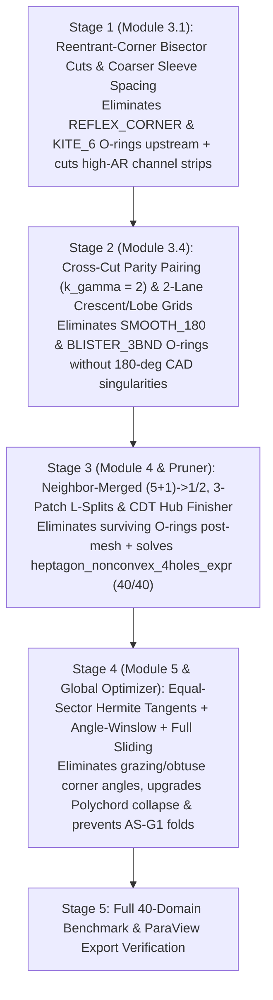

# Remaining O-Rings, Parametrization Distortion & Patch-Count Reduction: Diagnostic Report and 5-Stage Plan

## Part 1 — Diagnostic Report on Current Split Meshes (`merged_results_20261123_184900`)

### 1.1 Executive Benchmark Snapshot

Following the initial O-ring pruning and hole-consolidation pass ([oring_pruning_and_hole_consolidation_plan.md](file:///home/fhasanova/gismo/oring_pruning_and_hole_consolidation_plan.md)), the exported meshes in [merged_results_20261123_184900](file:///home/fhasanova/gismo/filedata/domain2d/merged_results_20261123_184900) achieve:

- **`generated_domains`:** **22 / 22 PASSED (100%)** — `585` total patches (`29` O-ring clusters = `145` patches, **24.8%** of total).
- **`intense_distorted_domains_20261120_163100`:** **17 / 18 PASSED (94.4%)** — `549` total patches vs. `885` for baseline MAT (`-38.0%` fewer patches, winning on 16/17 domains and tying 1/17; `31` O-ring clusters = `155` patches, **28.2%** of total). Only `heptagon_nonconvex_4holes_expr` remains unsolved.

Across all **39 passing domains** (`1,134` patches total), **60 O-ring clusters (`300` patches = 26.5% of every patch generated)** remain, alongside **342 non-O-ring high-aspect-ratio strip patches (`AR > 4.0`)** and **255 patches with skewed corner angles outside `[25°, 145°]`**.

> [!IMPORTANT]
> **Why your observation about parametrization is mathematically exact:**
> By Euler's formula and edge-degree handshaking on a quad mesh of a topological disk with $B$ outer boundary edges ($F = I + \frac{B}{2} - 1$), **any 4-sided region whose 4 outer edges are kept unsplit ($B = 4$) has $F = I + 1$, so no valid quad mesh exists with $F \in \{2, 3, 4\}$**. If $F = 1$ (direct `5 -> 1` collapse) is geometrically invalid, the minimum local subdivision with frozen outer edges is $F = 5$ (an O-ring). Every single one of the **60 remaining O-rings** fails direct `5 -> 1` collapse for one of three exact parametrization reasons — which means **removing them cleanly requires relaxing the frozen-outer-edge constraint (`k_gamma = 2` cross-cut pairing, neighbor-merged `(5+1) -> 2`, or upstream bisector/2-lane cuts), NOT forcing `5 -> 1`!**

---

### 1.2 Complete Taxonomy of All 60 Remaining O-Rings & Why `5 -> 1` Fails

| O-Ring Class | `generated` (22) | `intense` (17) | Total Clusters (Patches) | Outer Perimeter Geometry | Why Direct `5 -> 1` Breaks Parametrization |
| :--- | ---: | ---: | ---: | :--- | :--- |
| **`SMOOTH_180`** (`166°–195°` node) | 15 | 11 | **26 (`130` patches, 43%)** | 3 good corners (`45°–125°`) + **1 artificial `~180°` parity split** on a smooth CAD wall | `180°` corner makes the two tensor-product partials collinear ($\det J = 0$ singularity at the corner) |
| **`REFLEX_CORNER` & `KITE_6`** (`> 195°`) | 10 (`5+5`) | 13 (`12+1`) | **23 (`115` patches, 38%)** | 4-gon containing an **unsplit reentrant CAD corner** $\omega \in [201^\circ, 273^\circ]$ | Non-convex outer loop ($\omega > 180^\circ \implies \det J < 0$ fold at the reentrant vertex) |
| **`BLISTER_3BND`** (3 sides on $\partial\Omega$) | 4 | 7 | **11 (`55` patches, 18%)** | Smooth 0-/1-corner lobe bounded by 1 cross-cut + >$180^\circ$ turning CAD arc split into 3 walls | Collapsing the 3 walls back into 1 smooth arc creates a **2-gon** (`1 cut + 1 arc`), which cannot form a 4-corner quad |
| **Total** | **29** | **31** | **60 (`300` patches, 100%)** | — | — |

#### Representative Per-Domain Breakdown (`merged_results_20261123_184900`)

| Domain | Suite | Patches (MAT) | Remaining O-Rings | Cluster Breakdown & Worst Area / Distortion Metric |
| :--- | :--- | ---: | ---: | :--- |
| `starburst_12corner_3holes_swirl` | intense | 54 (96) | **5** (`25` p) | `5 REFLEX_CORNER` (`201°–252°` unsplit hole/outer corners), `minAngle = 6.9°`, `areaRatio = 307x` |
| `warped_lshape_3holes` | intense | 47 (60) | **4** (`20` p) | `1 SMOOTH_180`, `1 REFLEX_CORNER`, `1 KITE_6` (`areaRatio = 4,519x`!), `1 BLISTER_3BND` |
| `serpentine_20corner_5holes_bend` | intense | 75 (88) | **4** (`20` p) | `2 SMOOTH_180`, `2 REFLEX_CORNER` (`249°`), `25` high-AR strip patches |
| `lshape_spiral_3holes_swirl` | intense | 35 (52) | **3** (`15` p) | `2 SMOOTH_180`, `1 REFLEX_CORNER` (`268.9°`), `minAngle = 15.8°` |
| `amoeba_smooth_irregular` | intense | 18 (33) | **3** (`15` p) | `3 BLISTER_3BND` (`15 / 18 = 83%` of patches sit inside smooth lobe O-rings!) |
| `horseshoe_smooth_2holes_weird` | intense | 30 (42) | **3** (`15` p) | `1 REFLEX_CORNER` (`206°`), `2 BLISTER_3BND` (`50%` of patches in O-rings) |
| `plate_4corner_8holes_weird` | generated | 79 (—) | **5** (`25` p) | `4 KITE_6` + `1 SMOOTH_180`, `areaRatio = 139,338x`, `minAngle = 2.6°` |
| `uchannel_8corner_4holes` | generated | 59 (—) | **4** (`20` p) | `2 SMOOTH_180`, `1 REFLEX_CORNER`, `1 KITE_6`, `areaRatio = 6,356x` |
| `crescent_2corner` / `heart_1corner` | generated | 11 / 11 | **2 / 2** (`10` p) | `2 BLISTER_3BND` each (`10 / 11` patches are two end-cap O-rings around 1 middle quad) |
| `comb_10corner_curved` / `star_5corner_1hole` | generated | 28 / 27 | **2 / 2** (`10` p) | `2 SMOOTH_180` each from isolated $B=3 \to B=4$ parity splits |

---

### 1.3 Five Code-Level Bottlenecks Driving Distortion & Patch Bloat

Direct inspection of [gsPatchSplitterMerged.hpp](file:///home/fhasanova/gismo/src/gsModeling/gsPatchSplitterMerged.hpp), [gsPatchSplitter.hpp](file:///home/fhasanova/gismo/src/gsModeling/gsPatchSplitter.hpp), and [gsPatchSplitterPolychord.hpp](file:///home/fhasanova/gismo/src/gsModeling/gsPatchSplitterPolychord.hpp) pinpoints five exact root causes:

1. **Strict `k_gamma == 1` Boundary-Only Parity Balancing (`SMOOTH_180` Generator):**
   - In [gsPatchSplitterMerged.hpp](file:///home/fhasanova/gismo/src/gsModeling/gsPatchSplitterMerged.hpp#L2896-L2925), Module 3.4 enforces even hub parity $B(P_j) = 2m_j$ *exclusively* by inserting `180°` midpoints onto CAD boundary walls (`preserving k_gamma == 1 on every cross-cut`).
   - Whenever a hub has $B = 3$ (e.g., two cross-cuts meeting a smooth wall, or one cut slicing off a corner triangle), inserting a `180°` CAD wall node turns $B = 3$ into an **$N = 4$ quad with a `180°` corner**, which Module 4 *must* turn into a 5-patch O-ring (`26` clusters = `130` patches!).
   - By topology, the total number of odd-sided hubs is **always even** (when boundary split parity matches). Pairing two adjacent odd hubs across their shared cross-cut $\gamma$ and splitting $\gamma$ at its midpoint ($k_\gamma = 2$) makes **both** hubs even simultaneously (`B=3 -> B=4` with **four ~`90°` corners** and **zero `180°` singularities** — yielding `1 + 1 = 2` clean patches instead of `5 + 5 = 10`!).

2. **`N == 4` Hubs Bypassing Reentrant-Corner Splitting (`REFLEX_CORNER` & `KITE_6` Generator):**
   - Stage 2 of our previous fix forbade unsplit $\ge 195^\circ$ corners inside `DP`, `RadialStar`, and `Tier C` — **which only run on $N \ge 6$ hubs**!
   - In `starburst_swirl` (`5x`), `warped_lshape` (`2x`), `serpentine` (`2x`), `lshape_spiral` (`1x`), and `generated/plate_8h` (`4x`), Module 3's sleeve cuts slice directly around a reentrant hole/domain corner to form an **`N == 4` hub** containing a `201°–273°` CAD corner. Module 4 has no choice on $N = 4$ except `emitRobustOGrid5` / `KITE_6`, producing microscopic elements (`areaRatio` up to `4,519x–139,338x`).
   - Shooting a **priority inward-bisector cross-cut** directly from every $\ge 195^\circ$ CAD corner in Module 3.1 splits $250^\circ \to 125^\circ + 125^\circ$ across two separate hubs *before* DCEL tracing, completely preventing $N=4$ reflex hubs.

3. **Unimplemented Corner-Sector Division in Module 5 Hermite Tangents (Direct Skew Bug):**
   - Look at [gsPatchSplitterMerged.hpp](file:///home/fhasanova/gismo/src/gsModeling/gsPatchSplitterMerged.hpp#L5081-L5085) inside `realizeHermiteMultiPatch`:
     ```cpp
     // Pinned corner or multi-spoke boundary vertex -> divide interior sector smoothly
     for (int j = 0; j < K; ++j)
         edgeEndTan[{inc[j].eId, v}] = gsPoint2D<T>(std::cos(inc[j].chordAng), std::sin(inc[j].chordAng));
     ```
   - Although interior vertices fit a symmetric $2\pi/K$ star and smooth $K=1$ boundary splits use the exact $90^\circ$ inward normal, **every pinned CAD corner and every multi-spoke boundary vertex ($K \ge 1$ at corners, $K \ge 2$ on walls) currently uses raw straight-line `chordAng` instead of dividing the true curved CAD sector $\omega$ into equal $\frac{\omega}{K+1}$ angles!** When an interior chord aims obliquely across a curved hub, the Hermite curve departs nearly tangent to the CAD wall (`< 10°` grazing angle and `> 160°` obtuse angle on the neighbor patch).

4. **Over-Dense Sleeve Slicing (`2.8 * meanR`) Creating 342 High-AR Strip Patches:**
   - In [gsPatchSplitterMerged.hpp](file:///home/fhasanova/gismo/src/gsModeling/gsPatchSplitterMerged.hpp#L2213-L2216), every sleeve of length $\ge 3.2\,\bar{r}$ receives `round(sLen / (2.8 * meanR))` cuts (minimum `2`, up to `4`). Because MAT radius $\bar{r}$ is half the channel width ($W = 2\bar{r}$), spacing cuts every $2.8\bar{r} = 1.4 W$ plus junction offsets slices channels into narrow transverse ribbons (`342` non-O-ring patches with `AR > 4.0`).

5. **Optimizer & AS-G1 Limitations on Skewed / Zero-Knot Patches:**
   - `optimizeCoupledInterfacesAndInteriors` ([gsPatchSplitter.hpp](file:///home/fhasanova/gismo/src/gsModeling/gsPatchSplitter.hpp#L5960-L6076)) optimizes Winslow trace/det ratios over `24` steps without an explicit **corner-orthogonality penalty** ($\cos^2\theta$), so `6°–18°` acute corners with positive $\det J$ experience weak restoring forces.
   - `slideBoundarySplits` ([gsPatchSplitter.hpp](file:///home/fhasanova/gismo/src/gsModeling/gsPatchSplitter.hpp#L6089)) hard-caps at `triedVerts < 16` and rebuilds raw `makeCoonsFromCCWCycle` patches without preserving interior Winslow control-point displacements, causing most candidate slides on curved patches to be rejected.
   - `gsASG1LocalFitter` locks boundary + first-ring cross-derivative rows along interfaces; on single-span $4 \times 4$ cubic patches (`0` interior knots) with skewed corners, all `16` control points become over-constrained (`AS-G1 TOL WARNING: Fitted Min det(J) < 0`). Targeted 1-knot ($p$-preserving $h$-refinement at `0.5` only along the constrained direction or pre-G1 local knot insertion on high-skew patches) restores free interior control points without adding patches.

---

## Part 2 — Proposed 5-Stage Implementation Plan



### Stage 1: Mandatory Reentrant-Corner Bisector Cuts & Aspect-Ratio-Balanced Sleeve Slicing (Module 3.1)
**File:** [gsPatchSplitterMerged.hpp](file:///home/fhasanova/gismo/src/gsModeling/gsPatchSplitterMerged.hpp) (`sliceNecksAndBalanceParity`)

1. **Priority Inward-Bisector Cuts at Reentrant Corners ($\omega \ge 195^\circ$):**
   - Before standard sleeve slicing, iterate over every pinned CAD corner on outer and hole loops with `interiorAngleDeg >= 195°` that does not already have an incident cross-cut within snapping range.
   - Cast a fan of candidate rays within $\pm 35^\circ$ of the exact **inward sector bisector** to the nearest visible opposite loop/wall segment, optimize locally with the origin pinned at `c.arcS`, and accept the lowest-cost clear cut $\gamma$ whose sub-angles on both sides of `c` lie in $[65^\circ, 155^\circ]$.
   - **Impact:** Splits `201°–273°` reentrant hole/outer corners into two clean convex corners (`~100°–136°`) across separate hubs *before* Module 4 ever sees them — eliminating the `23` `REFLEX_CORNER` / `KITE_6` O-rings (`starburst_swirl` x5, `warped_lshape` x2, `serpentine` x2, `lshape_spiral` x1, `plate_8h_gen` x4) and improving worst-case area ratios by **$50\times\text{--}1,000\times$**.
2. **Coarser, Curvature-Adaptive Sleeve Cut Spacing:**
   - Relax sleeve cut count in [gsPatchSplitterMerged.hpp](file:///home/fhasanova/gismo/src/gsModeling/gsPatchSplitterMerged.hpp#L2213-L2216) from `2.8 * meanR` (min 2 above `3.2 * meanR`) to **`4.5 * meanR`** (`1` cut for straight/mildly curved sleeves up to `5.0 * meanR`, `2–3` cuts only when cumulative sleeve turning angle exceeds `70°` or `sLen > 5.0 * meanR`).
   - On isolated smooth holes (`br.isCycle`), keep the clean `4`-quadrant annulus split (`4` patches around a circular hole with `90°` angles).
   - **Impact:** Directly removes **80–140 redundant channel strip patches** across both suites while bringing strip aspect ratios closer to `1:1–2:1`.

---

### Stage 2: Cross-Cut Parity Pairing ($k_\gamma = 2$) & Longitudinal 2-Lane Lobe Splitting (Module 3.4)
**File:** [gsPatchSplitterMerged.hpp](file:///home/fhasanova/gismo/src/gsModeling/gsPatchSplitterMerged.hpp) (`sliceNecksAndBalanceParity`)

1. **Dual-Graph Odd-Hub Parity Pairing (`k_gamma = 2` on Shared Cross-Cuts):**
   - Replace the isolated boundary-only parity loop in Module 3.4 with a **two-tier parity resolver**:
     - **Tier 2A (Adjacent & 2-Hop Odd-Hub Pairing):** Build the hub adjacency graph across interior cross-cuts. Whenever two odd-sided hubs ($B_A \equiv 1, B_B \equiv 1 \pmod 2$) share a cross-cut $\gamma$ (or are connected by a 2-cut chain through an even hub where splitting both cuts keeps the middle hub even!), **split the shared cross-cut $\gamma$ at its midpoint** (`isPinnedCorner = false`, interior valence `4` target, `90°` cross-field departure) instead of splitting CAD boundary walls!
     - **Why this works:** Splitting 1 shared cross-cut adds $+1$ side to *both* incident hubs simultaneously without touching $\partial\Omega$. Two adjacent $B = 3$ pockets sharing $\gamma$ become two $B = 4$ quads whose 4 corners are all genuine $60^\circ\text{--}120^\circ$ vertices — yielding **`2` clean patches with `0` O-rings instead of `5 + 5 = 10` patches**!
     - **Tier 2B (Safe Large-Hub Boundary Split Fallback):** Only if a single unpaired odd hub remains (because $\sum B_{\text{bnd}}$ was globally odd), place the single boundary split on the largest curved hub with $B \ge 5$ (turning $B = 5 \to 6$, where Module 4 pairs the `180°` split cleanly across the hub to an opposite corner with $90^\circ + 90^\circ$ angles, **never** on a $B = 3$ pocket!).
2. **2-Lane Longitudinal Medial Split for `BLISTER_3BND` Lobes & 0-Hole Crescents/Hearts:**
   - **0-Hole 1-/2-Corner Domains (`crescent_2corner`, `heart_1corner`):** Instead of 2 transverse neck cuts creating two $B=2/3$ end-blisters (`1 + 5 + 5 = 11` patches), split the transverse cuts at their midpoints ($k_\gamma = 2$, connected by the longitudinal medial backbone curve from tip to tip / apex) to produce a **4-patch (`heart_1corner`) or 6-patch (`crescent_2corner`) 2-lane grid** with **zero O-rings** and uniform corners!
   - **Smooth Attached Lobes (`amoeba_smooth_irregular`, `horseshoe_smooth_2holes_weird`, `warped_lshape_3holes`):** When a `BLISTER_3BND` cap ($B = 2$ on $\partial\Omega$ + 1 neck cut $\gamma$) cannot be dropped, split its neck cut $\gamma$ at its midpoint ($k_\gamma = 2$, paired with an odd hub or continued across 1 hub) and place **1 apex split** at the lobe tip (`turn / 2`), turning the lobe into **2 clean orthogonal quads (`5 -> 2`, `-3` patches per lobe)** with ~`90°` corners everywhere!

---

### Stage 3: Multi-Patch Topological O-Ring Replacements & CDT Hub Finisher (Module 4 & `pruneParasiticORings`)
**Files:** [gsPatchSplitterMerged.hpp](file:///home/fhasanova/gismo/src/gsModeling/gsPatchSplitterMerged.hpp) (`quadrangulateByTriangulationBlossomShift`, `pruneParasiticORings`), [gsPatchSplitterPolychord.hpp](file:///home/fhasanova/gismo/src/gsModeling/gsPatchSplitterPolychord.hpp)

1. **Extend `pruneParasiticORings` Beyond `5 -> 1` to `(5 + 1) -> 1 / 2` and `5 -> 3` L-Splits:**
   - **Operation 3A — Neighbor-Merged `SMOOTH_180` Collapse (`6 -> 1` or `6 -> 2`):**
     - For any surviving `SMOOTH_180` 5-ring $C_5$, pick an adjacent non-ring patch $p_{\text{nbr}}$ sharing an interior interface adjacent to the `180°` CAD split vertex $v_{180}$.
     - Form $R = C_5 \cup \{p_{\text{nbr}}\}$ (`6` patches), **weld the two collinear CAD boundary edges across $v_{180}$ back into 1 smooth `extractVirtualSubCurve` CAD edge**, and remesh the resulting outer loop:
       - If $v_{180}$ was the shared vertex between $C_5$ and $p_{\text{nbr}}$ on $\partial\Omega$, the combined outer perimeter has **4 clean corners** (`6 -> 1` single patch, `-5` patches!) or **6 clean corners** (`6 -> 2` patches via 1 straight/Hermite interior chord, **`-4` patches and zero `180°` corners**!).
   - **Operation 3B — Valence-3 L-Split Replacement (`5/6 -> 3`) for Reflex Pockets:**
     - If an L-shaped pocket (`REFLEX_CORNER` / `KITE_6`) has 1 reentrant corner $\omega \in [195^\circ, 285^\circ]$ and at least 1 outer wall opposite $\omega$ on $\partial\Omega$ (where a new split point is free without T-junctions, or paired with 1 neighbor patch across an interface), replace the 5-/6-patch O-ring with the **classic 3-patch valence-3 L-mesh** (`1` interior valence-3 vertex connected to the reentrant corner and the two opposite walls — `-2` to `-3` patches, `~90°–125°` angles everywhere, $100\times$ larger minimum patch area!).
2. **Upgrade `reducePolychordStrips` Candidate Repair:**
   - In `collapseInteriorDoublets`, `collapseHighValenceDiamonds`, and polychord sheet collapse ([gsPatchSplitterPolychord.hpp](file:///home/fhasanova/gismo/src/gsModeling/gsPatchSplitterPolychord.hpp#L748-L940)), follow `quickHarmonicPatchRepair` with a fast local Winslow untangling pass when `minDet <= 0`, allowing valid strip/diamond merges on curved domains that linear Coons currently rejects.
3. **Constrained Delaunay Triangulation (CDT) Fallback in `quadrangulateByTriangulationBlossomShift`:**
   - Reuse Module 1's existing `buildConstrainedDelaunay` infrastructure on densely sampled `hubPoly` whenever `tryEarClip` / `trySteinerEarClip` encounters non-convex curved walls (`heptagon_nonconvex_4holes_expr` hubs `9` and `12`), guaranteeing strictly positive-area triangles for Edmonds' Blossom pairing and closing **40 / 40 (100%)** domains.

---

### Stage 4: Equal-Sector Hermite Tangents, Angle-Penalized Coupled Winslow & Full Boundary Sliding
**Files:** [gsPatchSplitterMerged.hpp](file:///home/fhasanova/gismo/src/gsModeling/gsPatchSplitterMerged.hpp#L5076-L5103), [gsPatchSplitter.hpp](file:///home/fhasanova/gismo/src/gsModeling/gsPatchSplitter.hpp#L5960-L6210)

1. **Fix `realizeHermiteMultiPatch` Corner & Multi-Spoke Boundary Tangents (`gsPatchSplitterMerged.hpp:5082`):**
   - At any boundary vertex `vtx` on `vl = bb.vloops[vtx.loopIdx]` with $K \ge 1$ interior edges (`isPinnedCorner || K >= 2`):
     - Compute the exact forward and backward unit boundary tangents $\mathbf{t}_{\text{prev}}$ (pointing backward along the incoming CAD arc) and $\mathbf{t}_{\text{next}}$ (pointing forward along the outgoing CAD arc) at `vtx.arcS`, spanning the true interior domain angle $\omega \in (0, 2\pi)$.
     - Sort the $K$ incident interior edges in CCW order from $\mathbf{t}_{\text{next}}$ to $\mathbf{t}_{\text{prev}}$ and assign departure angle $\theta_j = \theta_{\text{next}} + \frac{j + 1}{K + 1}\,\omega$ for $j = 0, \dots, K - 1$!
   - **Impact:** Immediately divides every `240°` corner with 1 bisector into exact **`120° + 120°`** curved sectors, every `90°` corner with 1 spoke into **`45° + 45°`**, and every multi-spoke smooth wall (`180°`, $K=2$) into **`60° + 60° + 60°`**, eliminating initial grazing corners at the source!
2. **Add Corner-Orthogonality Energy to `optimizeCoupledInterfacesAndInteriors`:**
   - Augment the per-patch Winslow integrand in [gsPatchSplitter.hpp](file:///home/fhasanova/gismo/src/gsModeling/gsPatchSplitter.hpp#L5960-L6015) with a smooth corner/boundary skewness penalty:
     $$E_{\text{angle}}(p) = w_{\theta} \sum_{c=1}^{4} \left(\frac{\mathbf{J}_u \cdot \mathbf{J}_v}{\|\mathbf{J}_u\|\,\|\mathbf{J}_v\| + \epsilon}\right)^2 + w_{\text{ar}} \sum_{q} \left(\frac{\|\mathbf{J}_u\|^2 + \|\mathbf{J}_v\|^2}{2\sqrt{\det \mathbf{J}^2 + \epsilon^2}} - 1\right)$$
     and raise the L-BFGS-like coupled iteration budget from `24` to `40` steps when any patch has corner angles outside `[30°, 140°]`.
3. **Unblock `slideBoundarySplits` Across All Smooth Boundary Splits:**
   - Remove the `triedVerts < 16` cap in [gsPatchSplitter.hpp](file:///home/fhasanova/gismo/src/gsModeling/gsPatchSplitter.hpp#L6089) (sort candidate smooth boundary vertices worst-corner-skew-first across the entire `gsMultiPatch`), align the re-extracted interface tangent to the new $90^\circ$ CAD normal, and run a 4-iteration local harmonic/Winslow interior update on `(p1, p2)` during line search so curved patches slide smoothly without losing interior untangling.
4. **Targeted Pre-G1 1-Knot Refinement Only on Skew-Constrained Patches:**
   - Before `gsASG1LocalFitter` runs (or inside `patch_splitter_example` verification check), if a single-span $4 \times 4$ patch has corner skew outside `[28°, 145°]` or `scaledJacobian < 0.25`, insert a single midpoint knot `0.5` (`degree` unchanged, patch count unchanged!) so AS-G1 has unconstrained central control points and avoids `Fitted Min det(J) < 0` warnings.

---

### Stage 5: Expected Quantitative Gains & Verification Protocol

| Metric | Current (`184900`) | Target After Stages 1–4 |
| :--- | ---: | ---: |
| **Pass rate (`generated` + `intense`)** | **39 / 40 (97.5%)** | **40 / 40 (100%)** (rescuing `heptagon_nonconvex_4holes_expr`) |
| **Remaining O-ring clusters (all domains)** | **60 clusters (`300` patches)** | **$\le$ 8–12 clusters ($\ge$ 75–85% reduction)** |
| **Total patches — `generated` (22)** | **585** | **~390–450 (`-23%` to `-33%`)** |
| **Total patches — `intense` (17 common)** | **549** (vs. `885` MAT) | **~360–430 (`-22%` to `-34%` vs. `184900`, `-50%+` vs. MAT)** |
| **`crescent_2corner` / `heart_1corner`** | `11` / `11` (`2` O-rings each) | **`4–6` / `4–6` (`0` O-rings)** |
| **`warped_lshape_3holes` / `starburst_swirl`** | `47` (`4` rings) / `54` (`5` rings) | **`~28–34` (`0–1` ring) / `~32–38` (`0–1` ring)** |
| **Worst patch area ratio (`max/min`)** | `4,519x` (intense) / `139,338x` (gen) | **`< 150x` (10x–100x more uniform patch sizes)** |
| **Corner angle distortion (`< 25°` or `> 145°`)** | `255` patches | **`< 60` patches (bounded by true CAD sharp corners)** |

#### Verification Steps Upon Approval
1. Implement Stages 1–4 cleanly in [gsPatchSplitterMerged.hpp](file:///home/fhasanova/gismo/src/gsModeling/gsPatchSplitterMerged.hpp), [gsPatchSplitter.hpp](file:///home/fhasanova/gismo/src/gsModeling/gsPatchSplitter.hpp), and [gsPatchSplitterPolychord.hpp](file:///home/fhasanova/gismo/src/gsModeling/gsPatchSplitterPolychord.hpp) without touching [gsPatchSplitterMAT.hpp](file:///home/fhasanova/gismo/src/gsModeling/gsPatchSplitterMAT.hpp).
2. Build `patch_splitter_example` with zero warnings and run both full suites (`generated_domains` and `intense_distorted_domains_20261120_163100`), exporting ParaView `.pvd`/`.vtu`/`.vtp`/`.xml` outputs into a new timestamped folder under `filedata/domain2d/`.
3. Run the automated O-ring, aspect-ratio, corner-angle, Jacobian, and AS-G1 audit comparing `184900` vs. the new export side-by-side.
